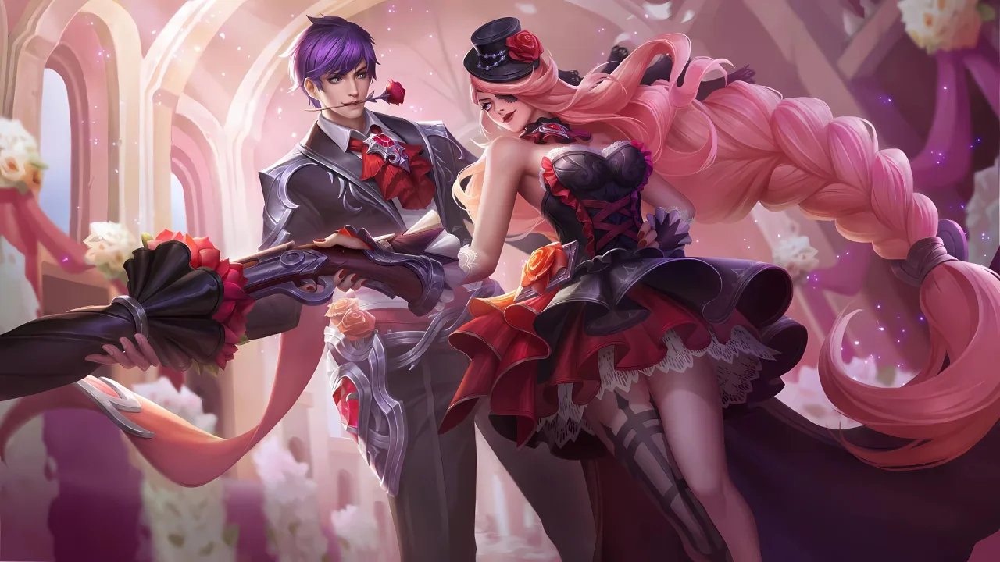
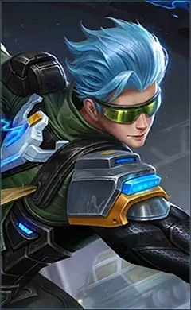

[Скины Госсена](https://boostmlbb.ru/skins/gusion.html)

[Скины](https://boostmlbb.ru/skins/)/[Госсен](https://boostmlbb.ru/skins/gusion.html)/Опасная связь

[Скин Госсена](https://boostmlbb.ru/skins/gusion.html)

# Опасная связь

Dangerous Liaison

Исключительный ExceptionalДень святого ВалентинаВ продаже

Как получить

Продаётся в магазине обликов за 749 алмазов.

Цена

749 алмазов

Вышел

февраль 2019

## Что меняет облик

-   Новая внешность
-   Новые эффекты навыков
-   Анимация показа
-   Бонус к характеристикам

## Перекраски

Тот же облик в других цветах. Перекраска открывается, только если у вас уже есть сам облик.

-   **Романтическая связь** Romantic LiaisonНаграда «Звёздного участника» в июне 2019.

## Все скины Госсена [12](https://boostmlbb.ru/skins/gusion.html)

[Пустынный паукИсключительный · 2024](https://boostmlbb.ru/skins/gusion/desert-spider.html)[К'Грандиозный · 2024](https://boostmlbb.ru/skins/gusion/k.html)[Странник измеренийГрандиозный · 2023](https://boostmlbb.ru/skins/gusion/dimension-walker.html)[Откровение душиДелюкс · 2023](https://boostmlbb.ru/skins/gusion/soul-revelation.html)[Косми­ческий отблескВысший · 2022](https://boostmlbb.ru/skins/gusion/cosmic-gleam.html)[Ночная соваИзысканный · 2021](https://boostmlbb.ru/skins/gusion/night-owl.html)[Импера­торский скорпион V.E.N.O.M.Делюкс · 2019](https://boostmlbb.ru/skins/gusion/v-e-n-o-m-emperor-scorpion.html)[Опасная связьИсключительный · 2019](https://boostmlbb.ru/skins/gusion/dangerous-liaison.html)[КиберотрядИсключительный · 2018](https://boostmlbb.ru/skins/gusion/cyber-ops.html)[СтилистОбычный · 2018](https://boostmlbb.ru/skins/gusion/hairstylist.html)[Лунная сонатаОбычный · 2018](https://boostmlbb.ru/skins/gusion/moonlight-sonata.html)[Минато Намикадзе](https://boostmlbb.ru/skins/gusion/minato-namikaze.html)

## Серия «День святого Валентина»

[Пылающее сердцеКлауд · 2024](https://boostmlbb.ru/skins/claude/heart-aflame.html)[Манящая загадкаГрейнджер · 2024](https://boostmlbb.ru/skins/granger/alluring-enigma.html)[Манящая мистикаСильвана · 2024](https://boostmlbb.ru/skins/silvanna/alluring-mystique.html)[Джентльмен-ворХуфра · 2023](https://boostmlbb.ru/skins/khufra/gentleman-thief.html)[Парящее сердцеФанни · 2022](https://boostmlbb.ru/skins/fanny/heart-afloat.html)[Призрачная графиняКармилла · 2021](https://boostmlbb.ru/skins/carmilla/phantom-countess.html)[Призрачный графСесилион · 2021](https://boostmlbb.ru/skins/cecilion/phantom-count.html)[Леди-воровкаЭсмеральда · 2020](https://boostmlbb.ru/skins/esmeralda/lady-thief.html)

**Сколько стоит буст на герое Госсен?**Выберите текущий и желаемый ранг. Стоимость появится на сайте.

[Рассчитать цену](https://boostmlbb.ru/order.html?type=hero)

## Частые вопросы

Как получить скин «Опасная связь» на Госсена?

Продаётся в магазине обликов за 749 алмазов.

Когда вышел скин «Опасная связь»?

Февраль 2019.

Какой класс у скина «Опасная связь»?

Исключительный (Exceptional), серия «День святого Валентина».
