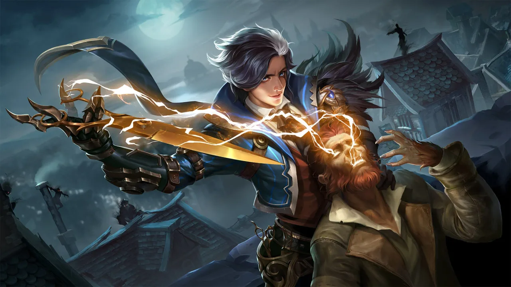

[Тир-лист](https://boostmlbb.ru/heroes/)[Предметы](https://boostmlbb.ru/items/)[Скины](https://boostmlbb.ru/skins/)[Новости и гайды](https://boostmlbb.ru/news/)

[Скины](https://boostmlbb.ru/skins/)/[Госсен](https://boostmlbb.ru/skins/gusion.html)/Стилист

[Скин Госсена](https://boostmlbb.ru/skins/gusion.html)

# Стилист

Hairstylist

Обычный CommonЭлитныйВ продаже

Как получить

Продаётся в магазине обликов за 599 алмазов.

Цена

599 алмазов

Вышел

август 2018

## Что меняет облик

-   Новая внешность
-   Другой цвет эффектов
-   Анимация показа
-   Бонус к характеристикам

## Перекраски

Тот же облик в других цветах. Перекраска открывается, только если у вас уже есть сам облик.

-   **Готический стилист** Gothic Hairstylist188 алмазов

## Все скины Госсена [12](https://boostmlbb.ru/skins/gusion.html)

[Пустынный паукИсключительный · 2024](https://boostmlbb.ru/skins/gusion/desert-spider.html)[К'Грандиозный · 2024](https://boostmlbb.ru/skins/gusion/k.html)[Странник измеренийГрандиозный · 2023](https://boostmlbb.ru/skins/gusion/dimension-walker.html)[Откровение душиДелюкс · 2023](https://boostmlbb.ru/skins/gusion/soul-revelation.html)[Косми­ческий отблескВысший · 2022](https://boostmlbb.ru/skins/gusion/cosmic-gleam.html)[Ночная соваИзысканный · 2021](https://boostmlbb.ru/skins/gusion/night-owl.html)[Импера­торский скорпион V.E.N.O.M.Делюкс · 2019](https://boostmlbb.ru/skins/gusion/v-e-n-o-m-emperor-scorpion.html)[Опасная связьИсключительный · 2019](https://boostmlbb.ru/skins/gusion/dangerous-liaison.html)[КиберотрядИсключительный · 2018](https://boostmlbb.ru/skins/gusion/cyber-ops.html)[СтилистОбычный · 2018](https://boostmlbb.ru/skins/gusion/hairstylist.html)[Лунная сонатаОбычный · 2018](https://boostmlbb.ru/skins/gusion/moonlight-sonata.html)[Минато Намикадзе](https://boostmlbb.ru/skins/gusion/minato-namikaze.html)

## Серия «Элитный»

[Золотой османтусЧан'Э · 2026](https://boostmlbb.ru/skins/change/golden-osmanthus.html)[Король-воена­чальникМартис · 2025](https://boostmlbb.ru/skins/martis/warlord-king.html)[Кадет открытого моряКимми · 2024](https://boostmlbb.ru/skins/kimmy/high-seas-cadet.html)[Зелёная копейщицаСильвана · 2024](https://boostmlbb.ru/skins/silvanna/verdant-lancer.html)[Мародёр Кровавое КопытоХилос · 2024](https://boostmlbb.ru/skins/hylos/bloodhoof-marauder.html)[Изящная бабочкаГвиневра · 2024](https://boostmlbb.ru/skins/guinevere/elegant-butterfly.html)[Маркиз клинковЛанселот · 2024](https://boostmlbb.ru/skins/lancelot/marques-of-blades.html)[Привал в пустошахЧип · 2024](https://boostmlbb.ru/skins/chip/badlands-hiatus.html)

**Поднимем ранг на герое Госсен**Цена считается в калькуляторе

[Рассчитать цену](https://boostmlbb.ru/order.html?type=hero)

## Частые вопросы

Как получить скин «Стилист» на Госсена?

Продаётся в магазине обликов за 599 алмазов.

Когда вышел скин «Стилист»?

Август 2018.

Какой класс у скина «Стилист»?

Обычный (Common), серия «Элитный».
