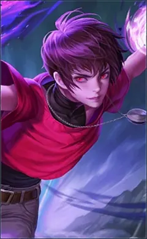

[Скины Госсена](https://boostmlbb.ru/skins/gusion.html)

[Скины](https://boostmlbb.ru/skins/)/[Госсен](https://boostmlbb.ru/skins/gusion.html)/К'

[Скин Госсена](https://boostmlbb.ru/skins/gusion.html)

# К'

K'

Грандиозный GrandThe King of FightersОграниченный

Как получить

Выходил в событии коллаборации MLBB × The King of Fighters. Ограниченные облики иногда возвращаются в розыгрышах событий.

Вышел

24 апреля 2024

## Что меняет облик

-   Новая внешность
-   Новые эффекты навыков
-   Звуки навыков
-   Своя озвучка
-   Иконки навыков
-   Анимация показа
-   Сцена показа
-   Музыка показа
-   Анимация появления
-   Особые действия
-   Бонус к характеристикам

## Все скины Госсена [12](https://boostmlbb.ru/skins/gusion.html)

[Пустынный паукИсключительный · 2024](https://boostmlbb.ru/skins/gusion/desert-spider.html)[К'Грандиозный · 2024](https://boostmlbb.ru/skins/gusion/k.html)[Странник измеренийГрандиозный · 2023](https://boostmlbb.ru/skins/gusion/dimension-walker.html)[Откровение душиДелюкс · 2023](https://boostmlbb.ru/skins/gusion/soul-revelation.html)[Косми­ческий отблескВысший · 2022](https://boostmlbb.ru/skins/gusion/cosmic-gleam.html)[Ночная соваИзысканный · 2021](https://boostmlbb.ru/skins/gusion/night-owl.html)[Импера­торский скорпион V.E.N.O.M.Делюкс · 2019](https://boostmlbb.ru/skins/gusion/v-e-n-o-m-emperor-scorpion.html)[Опасная связьИсключительный · 2019](https://boostmlbb.ru/skins/gusion/dangerous-liaison.html)[КиберотрядИсключительный · 2018](https://boostmlbb.ru/skins/gusion/cyber-ops.html)[СтилистОбычный · 2018](https://boostmlbb.ru/skins/gusion/hairstylist.html)[Лунная сонатаОбычный · 2018](https://boostmlbb.ru/skins/gusion/moonlight-sonata.html)[Минато Намикадзе](https://boostmlbb.ru/skins/gusion/minato-namikaze.html)

## Серия «The King of Fighters»

[Кё КусанагиВалир · 2024](https://boostmlbb.ru/skins/valir/kyo-kusanagi.html)[Терри БогардПакито · 2024](https://boostmlbb.ru/skins/paquito/terry-bogard.html)[Май ШирануиМаша · 2024](https://boostmlbb.ru/skins/masha/mai-shiranui.html)[Орочи КрисДариус · 2020](https://boostmlbb.ru/skins/dyrroth/orochi-chris.html)[Кула ДаймондАврора · 2019](https://boostmlbb.ru/skins/aurora/kula-diamond.html)[Афина АсамияГвиневра · 2019](https://boostmlbb.ru/skins/guinevere/athena-asamiya.html)[Иори ЯгамиЧу · 2019](https://boostmlbb.ru/skins/chou/iori-yagami.html)[ЛеонаКарина · 2019](https://boostmlbb.ru/skins/karina/leona.html)

**Сколько стоит буст на герое Госсен?**Выберите текущий и желаемый ранг. Стоимость появится на сайте.

[Рассчитать цену](https://boostmlbb.ru/order.html?type=hero)

## Частые вопросы

Как получить скин «К'» на Госсена?

Выходил в событии коллаборации MLBB × The King of Fighters. Ограниченные облики иногда возвращаются в розыгрышах событий.

Когда вышел скин «К'»?

24 апреля 2024.

Какой класс у скина «К'»?

Грандиозный (Grand), серия «The King of Fighters».
