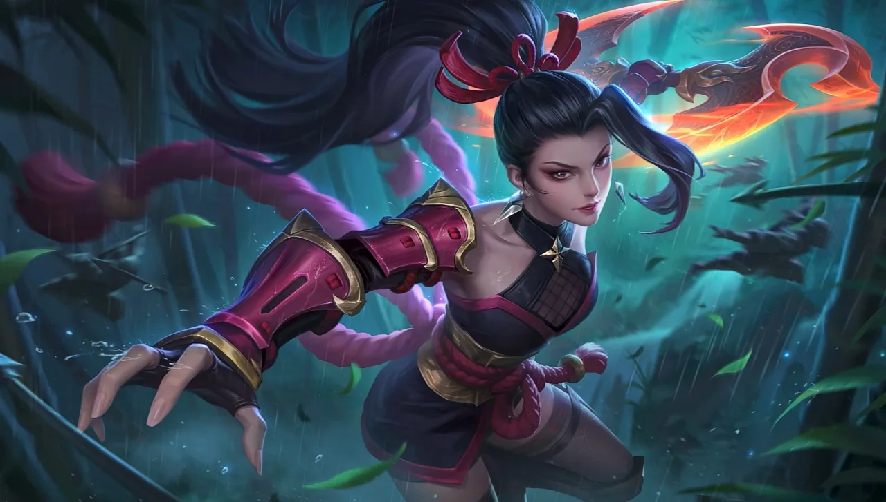

[Тир-лист](https://boostmlbb.ru/heroes/)[Предметы](https://boostmlbb.ru/items/)[Скины](https://boostmlbb.ru/skins/)[Новости и гайды](https://boostmlbb.ru/news/)

[Скины](https://boostmlbb.ru/skins/)/Ханаби

# Скины Ханаби

Скинов

12

Можно купить

4

Последний

[Двойной полумесяц](https://boostmlbb.ru/skins/hanabi/twin-crescent.html)2026

[Профиль героя→](https://boostmlbb.ru/heroes/hanabi.html)

## Все скины

ВсеГрандиозныйИзысканныйДелюксИсключительныйОбычный

[Двойной полумесяцИсключительный · 2026](https://boostmlbb.ru/skins/hanabi/twin-crescent.html)[Икона неонового городаИсключительный · 2026](https://boostmlbb.ru/skins/hanabi/neonscape-icon.html)[Шикарный гламурИсключительный · 2025](https://boostmlbb.ru/skins/hanabi/chic-glamour.html)[Сосуд яростиГрандиозный · 2023](https://boostmlbb.ru/skins/hanabi/vessel-of-rage.html)[Лунная ниндзяГрандиозный · 2023](https://boostmlbb.ru/skins/hanabi/moonlit-ninja.html)[Полевой опера­тивникИсключительный · 2022](https://boostmlbb.ru/skins/hanabi/field-op.html)[Феникс речных земельИзысканный · 2022](https://boostmlbb.ru/skins/hanabi/riverland-phoenix.html)[РакшасаИзысканный · 2020](https://boostmlbb.ru/skins/hanabi/rakshesha.html)[Нефила V.E.N.O.M.Делюкс · 2019](https://boostmlbb.ru/skins/hanabi/v-e-n-o-m-nephila.html)[Огненный мотылёкИсключительный · 2019](https://boostmlbb.ru/skins/hanabi/fiery-moth.html)[ГадюкаОбычный · 2018](https://boostmlbb.ru/skins/hanabi/viper.html)[Блиста­тельный ирисОбычный · 2018](https://boostmlbb.ru/skins/hanabi/resplendent-iris.html)

**Поднимем ранг на герое Ханаби**Цена считается в калькуляторе

[Рассчитать цену](https://boostmlbb.ru/order.html?type=hero)

## Частые вопросы

Сколько скинов у Ханаби?

12 скинов без стандартного облика. Последний — «Двойной полумесяц» (Twin Crescent), 17 февраля 2026.

Какие скины Ханаби можно купить сейчас?

«Полевой оперативник» (749 алмазов), «Нефила V.E.N.O.M.» (899 алмазов), «Гадюка» (599 алмазов), «Блистательный ирис» (269 алмазов). Остальные облики ограниченные и возвращаются только в событиях.

Какой самый редкий скин Ханаби?

«Сосуд ярости» (Vessel of Rage), класс грандиозный, серия «Сосуды души». Выходил в событии «Сосуды души». Ограниченные облики иногда возвращаются в розыгрышах событий.
