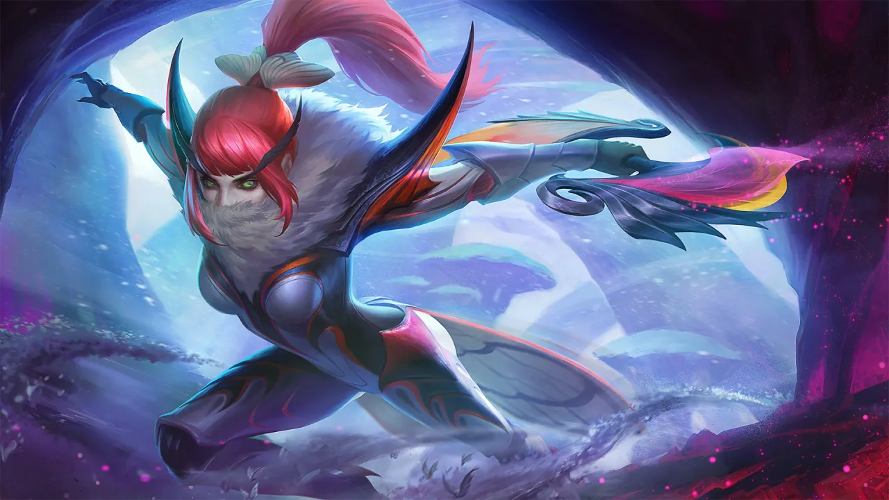
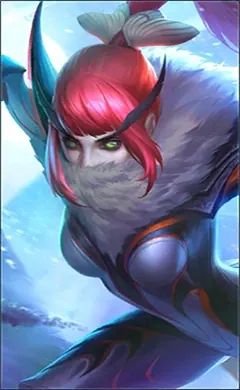

[Тир-лист](https://boostmlbb.ru/heroes/)[Предметы](https://boostmlbb.ru/items/)[Скины](https://boostmlbb.ru/skins/)[Новости и гайды](https://boostmlbb.ru/news/)

[Скины](https://boostmlbb.ru/skins/)/[Ханаби](https://boostmlbb.ru/skins/hanabi.html)/Огненный мотылёк

[Скин Ханаби](https://boostmlbb.ru/skins/hanabi.html)

# Огненный мотылёк

Fiery Moth

Исключительный ExceptionalЗвёздный участникОграниченный

Как получить

Награда «Звёздного участника» в апреле 2019.

Вышел

1 апреля 2019

## Что меняет облик

-   Новая внешность
-   Новые эффекты навыков
-   Анимация показа
-   Бонус к характеристикам

## Все скины Ханаби [12](https://boostmlbb.ru/skins/hanabi.html)

[Двойной полумесяцИсключительный · 2026](https://boostmlbb.ru/skins/hanabi/twin-crescent.html)[Икона неонового городаИсключительный · 2026](https://boostmlbb.ru/skins/hanabi/neonscape-icon.html)[Шикарный гламурИсключительный · 2025](https://boostmlbb.ru/skins/hanabi/chic-glamour.html)[Сосуд яростиГрандиозный · 2023](https://boostmlbb.ru/skins/hanabi/vessel-of-rage.html)[Лунная ниндзяГрандиозный · 2023](https://boostmlbb.ru/skins/hanabi/moonlit-ninja.html)[Полевой опера­тивникИсключительный · 2022](https://boostmlbb.ru/skins/hanabi/field-op.html)[Феникс речных земельИзысканный · 2022](https://boostmlbb.ru/skins/hanabi/riverland-phoenix.html)[РакшасаИзысканный · 2020](https://boostmlbb.ru/skins/hanabi/rakshesha.html)[Нефила V.E.N.O.M.Делюкс · 2019](https://boostmlbb.ru/skins/hanabi/v-e-n-o-m-nephila.html)[Огненный мотылёкИсключительный · 2019](https://boostmlbb.ru/skins/hanabi/fiery-moth.html)[ГадюкаОбычный · 2018](https://boostmlbb.ru/skins/hanabi/viper.html)[Блиста­тельный ирисОбычный · 2018](https://boostmlbb.ru/skins/hanabi/resplendent-iris.html)

## Серия «Звёздный участник»

[Морячка, рождённая приливомКалеа · 2026](https://boostmlbb.ru/skins/kalea/tideborn-sailor.html)[Тень кицунэХаябуса · 2026](https://boostmlbb.ru/skins/hayabusa/kitsune-s-shadow.html)[Клыки резниХанзо · 2026](https://boostmlbb.ru/skins/hanzo/fangs-of-slaughter.html)[Тлеющая крепостьБелерик · 2026](https://boostmlbb.ru/skins/belerick/smouldering-fortress.html)[Магитех­нический призракОбсидия · 2026](https://boostmlbb.ru/skins/obsidia/magitech-wraith.html)[Элизийское сияниеЦзэтянь · 2026](https://boostmlbb.ru/skins/zetian/elysian-luminance.html)[Батальон стражейХильда · 2026](https://boostmlbb.ru/skins/hilda/guardian-battalion.html)[Мечта­тельный коиХарли · 2026](https://boostmlbb.ru/skins/harley/dreaming-koi.html)

**Поднимем ранг на герое Ханаби**Цена считается в калькуляторе

[Рассчитать цену](https://boostmlbb.ru/order.html?type=hero)

## Частые вопросы

Как получить скин «Огненный мотылёк» на Ханаби?

Награда «Звёздного участника» в апреле 2019.

Когда вышел скин «Огненный мотылёк»?

1 апреля 2019.

Какой класс у скина «Огненный мотылёк»?

Исключительный (Exceptional), серия «Звёздный участник».
