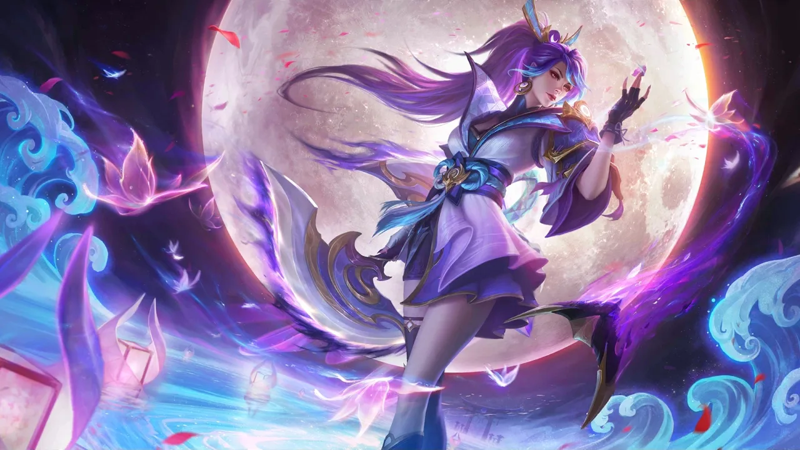
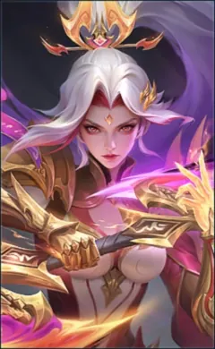

[Скины Ханаби](https://boostmlbb.ru/skins/hanabi.html)

[Скины](https://boostmlbb.ru/skins/)/[Ханаби](https://boostmlbb.ru/skins/hanabi.html)/Лунная ниндзя

[Скин Ханаби](https://boostmlbb.ru/skins/hanabi.html)

# Лунная ниндзя

Moonlit Ninja

Грандиозный GrandМатч всех звёздОграниченный

Как получить

Киберспортивный облик (Матч всех звёзд): выходил в событии турнира. Ограниченные облики иногда возвращаются в розыгрышах событий.

Вышел

16 апреля 2023

## Что меняет облик

-   Новая внешность
-   Новые эффекты навыков
-   Звуки навыков
-   Своя озвучка
-   Иконки навыков
-   Анимация показа
-   Сцена показа
-   Музыка показа
-   Анимация появления
-   Особые действия
-   Бонус к характеристикам

## Все скины Ханаби [12](https://boostmlbb.ru/skins/hanabi.html)

[Двойной полумесяцИсключительный · 2026](https://boostmlbb.ru/skins/hanabi/twin-crescent.html)[Икона неонового городаИсключительный · 2026](https://boostmlbb.ru/skins/hanabi/neonscape-icon.html)[Шикарный гламурИсключительный · 2025](https://boostmlbb.ru/skins/hanabi/chic-glamour.html)[Сосуд яростиГрандиозный · 2023](https://boostmlbb.ru/skins/hanabi/vessel-of-rage.html)[Лунная ниндзяГрандиозный · 2023](https://boostmlbb.ru/skins/hanabi/moonlit-ninja.html)[Полевой опера­тивникИсключительный · 2022](https://boostmlbb.ru/skins/hanabi/field-op.html)[Феникс речных земельИзысканный · 2022](https://boostmlbb.ru/skins/hanabi/riverland-phoenix.html)[РакшасаИзысканный · 2020](https://boostmlbb.ru/skins/hanabi/rakshesha.html)[Нефила V.E.N.O.M.Делюкс · 2019](https://boostmlbb.ru/skins/hanabi/v-e-n-o-m-nephila.html)[Огненный мотылёкИсключительный · 2019](https://boostmlbb.ru/skins/hanabi/fiery-moth.html)[ГадюкаОбычный · 2018](https://boostmlbb.ru/skins/hanabi/viper.html)[Блиста­тельный ирисОбычный · 2018](https://boostmlbb.ru/skins/hanabi/resplendent-iris.html)

**Сколько стоит буст на герое Ханаби?**Выберите текущий и желаемый ранг. Стоимость появится на сайте.

[Рассчитать цену](https://boostmlbb.ru/order.html?type=hero)

## Частые вопросы

Как получить скин «Лунная ниндзя» на Ханаби?

Киберспортивный облик (Матч всех звёзд): выходил в событии турнира. Ограниченные облики иногда возвращаются в розыгрышах событий.

Когда вышел скин «Лунная ниндзя»?

16 апреля 2023.

Какой класс у скина «Лунная ниндзя»?

Грандиозный (Grand), серия «Матч всех звёзд».
