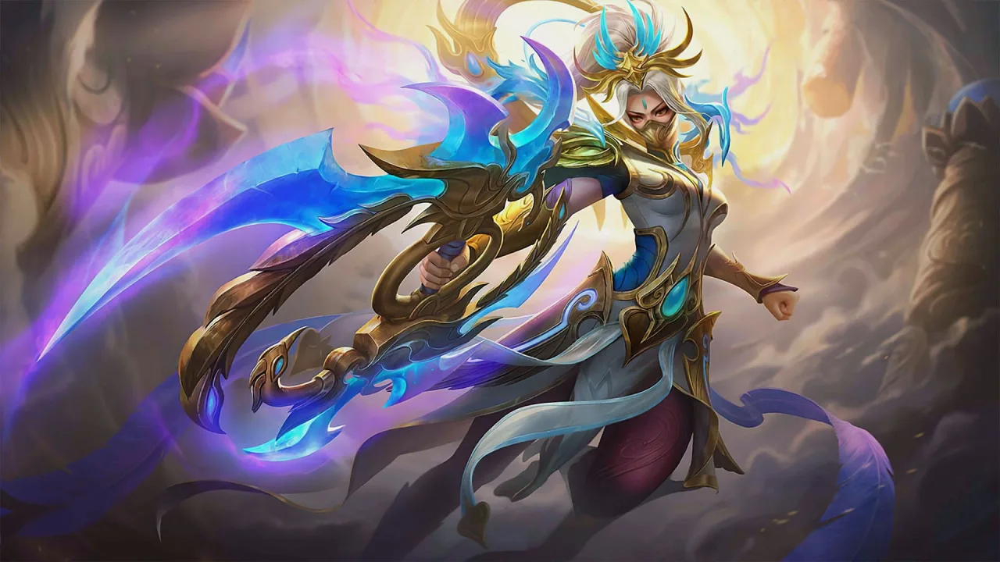

[Тир-лист](https://boostmlbb.ru/heroes/)[Предметы](https://boostmlbb.ru/items/)[Скины](https://boostmlbb.ru/skins/)[Новости и гайды](https://boostmlbb.ru/news/)

[Скины](https://boostmlbb.ru/skins/)/[Ханаби](https://boostmlbb.ru/skins/hanabi.html)/Феникс речных земель

[Скин Ханаби](https://boostmlbb.ru/skins/hanabi.html)

# Феникс речных земель

Riverland Phoenix

Изысканный ExquisiteКоллекционныйОграниченный

Как получить

Главный приз розыгрыша в коллекционном событии, попытки покупаются за алмазы. Ограниченные облики иногда возвращаются в розыгрышах событий.

Вышел

6 января 2022

## Что меняет облик

-   Новая внешность
-   Новые эффекты навыков
-   Звуки навыков
-   Своя озвучка
-   Анимация показа
-   Сцена показа
-   Особые действия
-   Бонус к характеристикам

## Все скины Ханаби [12](https://boostmlbb.ru/skins/hanabi.html)

[Двойной полумесяцИсключительный · 2026](https://boostmlbb.ru/skins/hanabi/twin-crescent.html)[Икона неонового городаИсключительный · 2026](https://boostmlbb.ru/skins/hanabi/neonscape-icon.html)[Шикарный гламурИсключительный · 2025](https://boostmlbb.ru/skins/hanabi/chic-glamour.html)[Сосуд яростиГрандиозный · 2023](https://boostmlbb.ru/skins/hanabi/vessel-of-rage.html)[Лунная ниндзяГрандиозный · 2023](https://boostmlbb.ru/skins/hanabi/moonlit-ninja.html)[Полевой опера­тивникИсключительный · 2022](https://boostmlbb.ru/skins/hanabi/field-op.html)[Феникс речных земельИзысканный · 2022](https://boostmlbb.ru/skins/hanabi/riverland-phoenix.html)[РакшасаИзысканный · 2020](https://boostmlbb.ru/skins/hanabi/rakshesha.html)[Нефила V.E.N.O.M.Делюкс · 2019](https://boostmlbb.ru/skins/hanabi/v-e-n-o-m-nephila.html)[Огненный мотылёкИсключительный · 2019](https://boostmlbb.ru/skins/hanabi/fiery-moth.html)[ГадюкаОбычный · 2018](https://boostmlbb.ru/skins/hanabi/viper.html)[Блиста­тельный ирисОбычный · 2018](https://boostmlbb.ru/skins/hanabi/resplendent-iris.html)

## Серия «Коллекционный»

[ОчистительБруно · 2026](https://boostmlbb.ru/skins/bruno/the-purifier.html)[Небесный бунтарьСан · 2026](https://boostmlbb.ru/skins/sun/celestial-rebel.html)[Кайдзю глубинХелкарт · 2026](https://boostmlbb.ru/skins/helcurt/kaiju-of-the-deep.html)[Звёздный дозорныйКимми · 2026](https://boostmlbb.ru/skins/kimmy/starbound-sentry.html)[Монархиня грёзАлиса · 2026](https://boostmlbb.ru/skins/alice/dreaming-monarch.html)[Дрожь глубинГрок · 2026](https://boostmlbb.ru/skins/grock/tremor-of-the-deep.html)[Небесный генералТигрил · 2026](https://boostmlbb.ru/skins/tigreal/celestial-general.html)[Монарх, рождённый солнцемКсавьер · 2026](https://boostmlbb.ru/skins/xavier/sunborn-monarch.html)

**Поднимем ранг на герое Ханаби**Цена считается в калькуляторе

[Рассчитать цену](https://boostmlbb.ru/order.html?type=hero)

## Частые вопросы

Как получить скин «Феникс речных земель» на Ханаби?

Главный приз розыгрыша в коллекционном событии, попытки покупаются за алмазы. Ограниченные облики иногда возвращаются в розыгрышах событий.

Когда вышел скин «Феникс речных земель»?

6 января 2022.

Какой класс у скина «Феникс речных земель»?

Изысканный (Exquisite), серия «Коллекционный».
