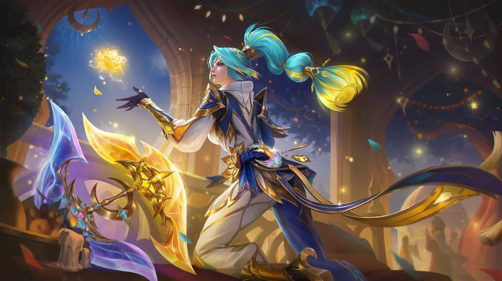

[Тир-лист](https://boostmlbb.ru/heroes/)[Предметы](https://boostmlbb.ru/items/)[Скины](https://boostmlbb.ru/skins/)[Новости и гайды](https://boostmlbb.ru/news/)

[Скины](https://boostmlbb.ru/skins/)/[Ханаби](https://boostmlbb.ru/skins/hanabi.html)/Двойной полумесяц

[Скин Ханаби](https://boostmlbb.ru/skins/hanabi.html)

# Двойной полумесяц

Twin Crescent

Исключительный ExceptionalЗолотой месяцОграниченный

Как получить

Выходил в событии «Золотой месяц». Ограниченные облики иногда возвращаются в розыгрышах событий.

Вышел

17 февраля 2026

## Что меняет облик

-   Новая внешность
-   Новые эффекты навыков
-   Анимация показа
-   Бонус к характеристикам

## Все скины Ханаби [12](https://boostmlbb.ru/skins/hanabi.html)

[Двойной полумесяцИсключительный · 2026](https://boostmlbb.ru/skins/hanabi/twin-crescent.html)[Икона неонового городаИсключительный · 2026](https://boostmlbb.ru/skins/hanabi/neonscape-icon.html)[Шикарный гламурИсключительный · 2025](https://boostmlbb.ru/skins/hanabi/chic-glamour.html)[Сосуд яростиГрандиозный · 2023](https://boostmlbb.ru/skins/hanabi/vessel-of-rage.html)[Лунная ниндзяГрандиозный · 2023](https://boostmlbb.ru/skins/hanabi/moonlit-ninja.html)[Полевой опера­тивникИсключительный · 2022](https://boostmlbb.ru/skins/hanabi/field-op.html)[Феникс речных земельИзысканный · 2022](https://boostmlbb.ru/skins/hanabi/riverland-phoenix.html)[РакшасаИзысканный · 2020](https://boostmlbb.ru/skins/hanabi/rakshesha.html)[Нефила V.E.N.O.M.Делюкс · 2019](https://boostmlbb.ru/skins/hanabi/v-e-n-o-m-nephila.html)[Огненный мотылёкИсключительный · 2019](https://boostmlbb.ru/skins/hanabi/fiery-moth.html)[ГадюкаОбычный · 2018](https://boostmlbb.ru/skins/hanabi/viper.html)[Блиста­тельный ирисОбычный · 2018](https://boostmlbb.ru/skins/hanabi/resplendent-iris.html)

## Серия «Золотой месяц»

[Неоновый клинокРуби · 2025](https://boostmlbb.ru/skins/ruby/neon-edge.html)[Дервиш полумесяцаРуби · 2025](https://boostmlbb.ru/skins/ruby/crescent-dervish.html)

**Поднимем ранг на герое Ханаби**Цена считается в калькуляторе

[Рассчитать цену](https://boostmlbb.ru/order.html?type=hero)

## Частые вопросы

Как получить скин «Двойной полумесяц» на Ханаби?

Выходил в событии «Золотой месяц». Ограниченные облики иногда возвращаются в розыгрышах событий.

Когда вышел скин «Двойной полумесяц»?

17 февраля 2026.

Какой класс у скина «Двойной полумесяц»?

Исключительный (Exceptional), серия «Золотой месяц».
