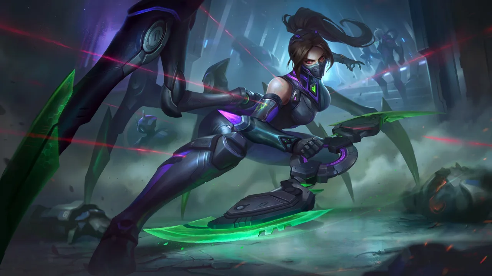
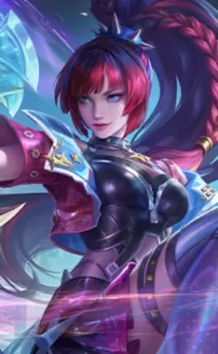
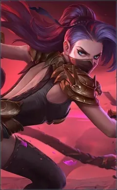
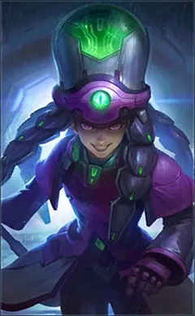

[Тир-лист](https://boostmlbb.ru/heroes/)[Предметы](https://boostmlbb.ru/items/)[Скины](https://boostmlbb.ru/skins/)[Новости и гайды](https://boostmlbb.ru/news/)

[Скины](https://boostmlbb.ru/skins/)/[Ханаби](https://boostmlbb.ru/skins/hanabi.html)/Нефила V.E.N.O.M.

[Скин Ханаби](https://boostmlbb.ru/skins/hanabi.html)

# Нефила V.E.N.O.M.

V.E.N.O.M. Nephila

Делюкс DeluxeV.E.N.O.M.В продаже

Как получить

Продаётся в магазине обликов за 899 алмазов.

Цена

899 алмазов

Вышел

27 июля 2019

## Что меняет облик

-   Новая внешность
-   Новые эффекты навыков
-   Звуки навыков
-   Анимация показа
-   Сцена показа
-   Бонус к характеристикам

## Все скины Ханаби [12](https://boostmlbb.ru/skins/hanabi.html)

[Двойной полумесяцИсключительный · 2026](https://boostmlbb.ru/skins/hanabi/twin-crescent.html)[Икона неонового городаИсключительный · 2026](https://boostmlbb.ru/skins/hanabi/neonscape-icon.html)[Шикарный гламурИсключительный · 2025](https://boostmlbb.ru/skins/hanabi/chic-glamour.html)[Сосуд яростиГрандиозный · 2023](https://boostmlbb.ru/skins/hanabi/vessel-of-rage.html)[Лунная ниндзяГрандиозный · 2023](https://boostmlbb.ru/skins/hanabi/moonlit-ninja.html)[Полевой опера­тивникИсключительный · 2022](https://boostmlbb.ru/skins/hanabi/field-op.html)[Феникс речных земельИзысканный · 2022](https://boostmlbb.ru/skins/hanabi/riverland-phoenix.html)[РакшасаИзысканный · 2020](https://boostmlbb.ru/skins/hanabi/rakshesha.html)[Нефила V.E.N.O.M.Делюкс · 2019](https://boostmlbb.ru/skins/hanabi/v-e-n-o-m-nephila.html)[Огненный мотылёкИсключительный · 2019](https://boostmlbb.ru/skins/hanabi/fiery-moth.html)[ГадюкаОбычный · 2018](https://boostmlbb.ru/skins/hanabi/viper.html)[Блиста­тельный ирисОбычный · 2018](https://boostmlbb.ru/skins/hanabi/resplendent-iris.html)

## Серия «V.E.N.O.M.»

[Кобра V.E.N.O.M.Дариус · 2022](https://boostmlbb.ru/skins/dyrroth/v-e-n-o-m-cobra.html)[Варан V.E.N.O.M.Грок · 2019](https://boostmlbb.ru/skins/grock/v-e-n-o-m-monitor-lizard.html)[Импера­торский скорпион V.E.N.O.M.Госсен · 2019](https://boostmlbb.ru/skins/gusion/v-e-n-o-m-emperor-scorpion.html)[Оса V.E.N.O.M.Ангела · 2019](https://boostmlbb.ru/skins/angela/v-e-n-o-m-vespid.html)[Осьминог V.E.N.O.M.Харли · 2019](https://boostmlbb.ru/skins/harley/v-e-n-o-m-octopus.html)

**Поднимем ранг на герое Ханаби**Цена считается в калькуляторе

[Рассчитать цену](https://boostmlbb.ru/order.html?type=hero)

## Частые вопросы

Как получить скин «Нефила V.E.N.O.M.» на Ханаби?

Продаётся в магазине обликов за 899 алмазов.

Когда вышел скин «Нефила V.E.N.O.M.»?

27 июля 2019.

Какой класс у скина «Нефила V.E.N.O.M.»?

Делюкс (Deluxe), серия «V.E.N.O.M.».
