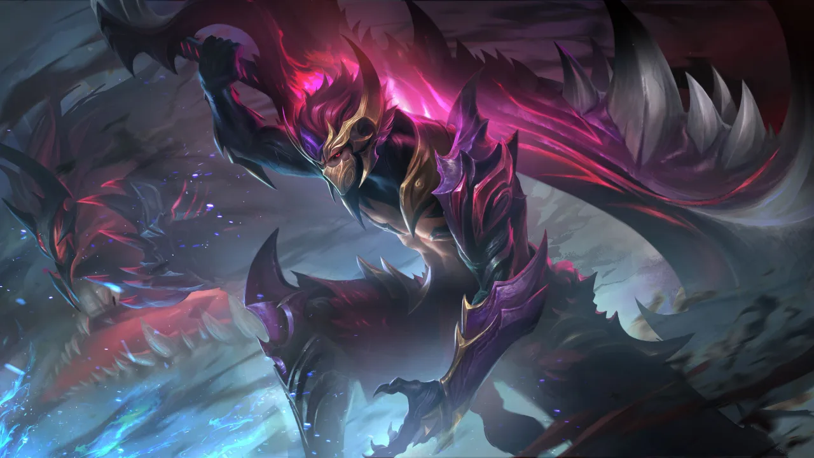

[Все скины](https://boostmlbb.ru/skins/)

[Скины](https://boostmlbb.ru/skins/)/Ханзо

# Скины Ханзо

Скинов

5

Можно купить

3

Последний

[Клыки резни](https://boostmlbb.ru/skins/hanzo/fangs-of-slaughter.html)2026

[Профиль героя→](https://boostmlbb.ru/heroes/hanzo.html)

## Все скины

[Клыки резниИсключительный · 2026](https://boostmlbb.ru/skins/hanzo/fangs-of-slaughter.html)[Владыка преис­подней с огнём душиИзысканный · 2025](https://boostmlbb.ru/skins/hanzo/soulfire-netherlord.html)[Король нежитиОбычный · 2023](https://boostmlbb.ru/skins/hanzo/undead-king.html)[Бледный фантомОбычный · 2022](https://boostmlbb.ru/skins/hanzo/the-pale-phantom.html)[Коварный наставникИсключительный · 2020](https://boostmlbb.ru/skins/hanzo/insidious-tutor.html)

**Сколько стоит буст на герое Ханзо?**Выберите текущий и желаемый ранг. Стоимость появится на сайте.

[Рассчитать цену](https://boostmlbb.ru/order.html?type=hero)

## Частые вопросы

Сколько скинов у Ханзо?

5 скинов без стандартного облика. Последний — «Клыки резни» (Fangs of Slaughter), 1 сентября 2026.

Какие скины Ханзо можно купить сейчас?

«Король нежити» (599 алмазов), «Бледный фантом» (269 алмазов), «Коварный наставник» (749 алмазов). Остальные облики ограниченные и возвращаются только в событиях.

Какой самый редкий скин Ханзо?

«Владыка преисподней с огнём души» (Soulfire Netherlord), класс изысканный, серия «Коллекционный». Главный приз розыгрыша в коллекционном событии, попытки покупаются за алмазы. Ограниченные облики иногда возвращаются в розыгрышах событий.
