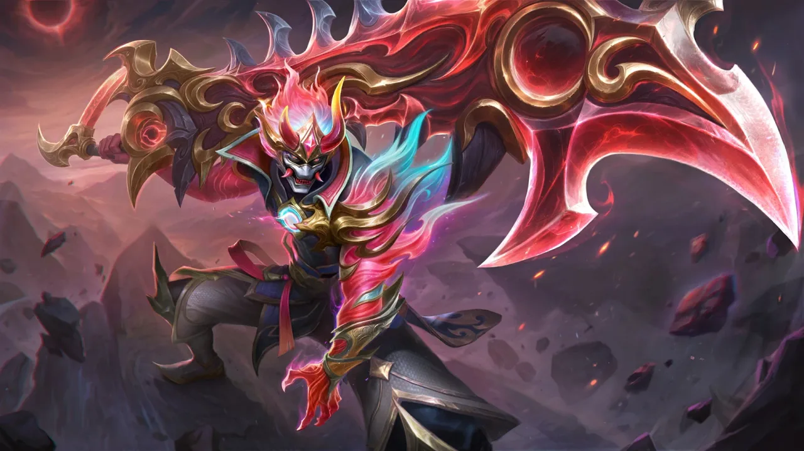
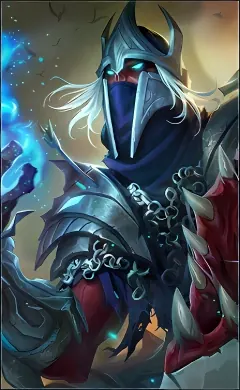

[Скины Ханзо](https://boostmlbb.ru/skins/hanzo.html)

[Скины](https://boostmlbb.ru/skins/)/[Ханзо](https://boostmlbb.ru/skins/hanzo.html)/Клыки резни

[Скин Ханзо](https://boostmlbb.ru/skins/hanzo.html)

# Клыки резни

Fangs of Slaughter

Исключительный ExceptionalЗвёздный участникОграниченный

Как получить

Награда «Звёздного участника» в сентябре 2026.

Вышел

1 сентября 2026

## Что меняет облик

-   Новая внешность
-   Бонус к характеристикам

## Все скины Ханзо [5](https://boostmlbb.ru/skins/hanzo.html)

[Клыки резниИсключительный · 2026](https://boostmlbb.ru/skins/hanzo/fangs-of-slaughter.html)[Владыка преис­подней с огнём душиИзысканный · 2025](https://boostmlbb.ru/skins/hanzo/soulfire-netherlord.html)[Король нежитиОбычный · 2023](https://boostmlbb.ru/skins/hanzo/undead-king.html)[Бледный фантомОбычный · 2022](https://boostmlbb.ru/skins/hanzo/the-pale-phantom.html)[Коварный наставникИсключительный · 2020](https://boostmlbb.ru/skins/hanzo/insidious-tutor.html)

## Серия «Звёздный участник»

[Морячка, рождённая приливомКалеа · 2026](https://boostmlbb.ru/skins/kalea/tideborn-sailor.html)[Тень кицунэХаябуса · 2026](https://boostmlbb.ru/skins/hayabusa/kitsune-s-shadow.html)[Тлеющая крепостьБелерик · 2026](https://boostmlbb.ru/skins/belerick/smouldering-fortress.html)[Магитех­нический призракОбсидия · 2026](https://boostmlbb.ru/skins/obsidia/magitech-wraith.html)[Элизийское сияниеЦзэтянь · 2026](https://boostmlbb.ru/skins/zetian/elysian-luminance.html)[Батальон стражейХильда · 2026](https://boostmlbb.ru/skins/hilda/guardian-battalion.html)[Мечта­тельный коиХарли · 2026](https://boostmlbb.ru/skins/harley/dreaming-koi.html)[Коро­левский маршалФредрин · 2025](https://boostmlbb.ru/skins/fredrinn/royal-marshal.html)

**Сколько стоит буст на герое Ханзо?**Выберите текущий и желаемый ранг. Стоимость появится на сайте.

[Рассчитать цену](https://boostmlbb.ru/order.html?type=hero)

## Частые вопросы

Как получить скин «Клыки резни» на Ханзо?

Награда «Звёздного участника» в сентябре 2026.

Когда вышел скин «Клыки резни»?

1 сентября 2026.

Какой класс у скина «Клыки резни»?

Исключительный (Exceptional), серия «Звёздный участник».
