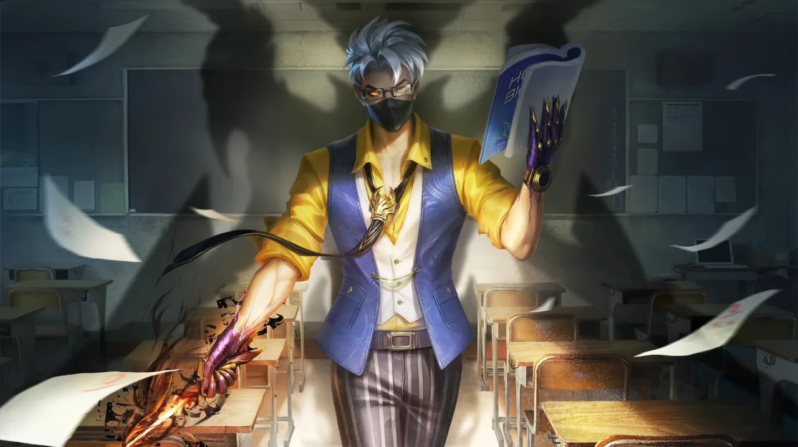

[Тир-лист](https://boostmlbb.ru/heroes/)[Предметы](https://boostmlbb.ru/items/)[Скины](https://boostmlbb.ru/skins/)[Новости и гайды](https://boostmlbb.ru/news/)

[Скины](https://boostmlbb.ru/skins/)/[Ханзо](https://boostmlbb.ru/skins/hanzo.html)/Коварный наставник

[Скин Ханзо](https://boostmlbb.ru/skins/hanzo.html)

# Коварный наставник

Insidious Tutor

Исключительный ExceptionalОсобыйВ продаже

Как получить

Продаётся в магазине обликов за 749 алмазов.

Цена

749 алмазов

Вышел

10 августа 2020

## Что меняет облик

-   Новая внешность
-   Новые эффекты навыков
-   Анимация показа
-   Бонус к характеристикам

## Перекраски

Тот же облик в других цветах. Перекраска открывается, только если у вас уже есть сам облик.

-   **Злой наставник** Evil TutorНаграда «Звёздного участника» в январе 2021.

## Все скины Ханзо [5](https://boostmlbb.ru/skins/hanzo.html)

[Клыки резниИсключительный · 2026](https://boostmlbb.ru/skins/hanzo/fangs-of-slaughter.html)[Владыка преис­подней с огнём душиИзысканный · 2025](https://boostmlbb.ru/skins/hanzo/soulfire-netherlord.html)[Король нежитиОбычный · 2023](https://boostmlbb.ru/skins/hanzo/undead-king.html)[Бледный фантомОбычный · 2022](https://boostmlbb.ru/skins/hanzo/the-pale-phantom.html)[Коварный наставникИсключительный · 2020](https://boostmlbb.ru/skins/hanzo/insidious-tutor.html)

## Серия «Особый»

[Тайный вердиктМатильда · 2026](https://boostmlbb.ru/skins/mathilda/arcane-verdict.html)[Вальс на ветруВэйл · 2026](https://boostmlbb.ru/skins/vale/windborne-waltz.html)[Капитан потерянныхФранко · 2026](https://boostmlbb.ru/skins/franco/captain-of-the-lost.html)[ВолнорезЛи Сун-Син · 2025](https://boostmlbb.ru/skins/yi-sun-shin/wavebreaker.html)[Стальные рукиБаданг · 2025](https://boostmlbb.ru/skins/badang/steel-arms.html)[Леди с зонтикомКагура · 2025](https://boostmlbb.ru/skins/kagura/lady-parasol.html)[Ужас пучиныАлдос · 2025](https://boostmlbb.ru/skins/aldous/fathom-terror.html)[Труппа лунного светаЧан'Э · 2025](https://boostmlbb.ru/skins/change/moonglow-troupe.html)

**Поднимем ранг на герое Ханзо**Цена считается в калькуляторе

[Рассчитать цену](https://boostmlbb.ru/order.html?type=hero)

## Частые вопросы

Как получить скин «Коварный наставник» на Ханзо?

Продаётся в магазине обликов за 749 алмазов.

Когда вышел скин «Коварный наставник»?

10 августа 2020.

Какой класс у скина «Коварный наставник»?

Исключительный (Exceptional), серия «Особый».
