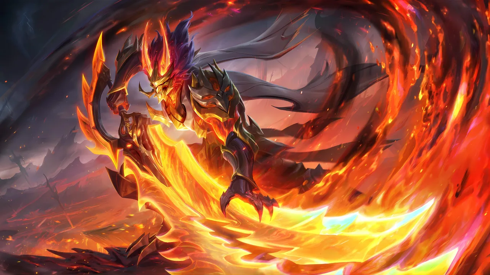

[Скины Ханзо](https://boostmlbb.ru/skins/hanzo.html)

[Скины](https://boostmlbb.ru/skins/)/[Ханзо](https://boostmlbb.ru/skins/hanzo.html)/Владыка преисподней с огнём души

[Скин Ханзо](https://boostmlbb.ru/skins/hanzo.html)

# Владыка преисподней с огнём души

Soulfire Netherlord

Изысканный ExquisiteКоллекционныйОграниченный

Как получить

Главный приз розыгрыша в коллекционном событии, попытки покупаются за алмазы. Ограниченные облики иногда возвращаются в розыгрышах событий.

Вышел

3 июля 2025

## Что меняет облик

-   Новая внешность
-   Новые эффекты навыков
-   Звуки навыков
-   Своя озвучка
-   Анимация показа
-   Сцена показа
-   Музыка показа
-   Особые действия
-   Бонус к характеристикам

## Все скины Ханзо [5](https://boostmlbb.ru/skins/hanzo.html)

[Клыки резниИсключительный · 2026](https://boostmlbb.ru/skins/hanzo/fangs-of-slaughter.html)[Владыка преис­подней с огнём душиИзысканный · 2025](https://boostmlbb.ru/skins/hanzo/soulfire-netherlord.html)[Король нежитиОбычный · 2023](https://boostmlbb.ru/skins/hanzo/undead-king.html)[Бледный фантомОбычный · 2022](https://boostmlbb.ru/skins/hanzo/the-pale-phantom.html)[Коварный наставникИсключительный · 2020](https://boostmlbb.ru/skins/hanzo/insidious-tutor.html)

## Серия «Коллекционный»

[ОчистительБруно · 2026](https://boostmlbb.ru/skins/bruno/the-purifier.html)[Небесный бунтарьСан · 2026](https://boostmlbb.ru/skins/sun/celestial-rebel.html)[Кайдзю глубинХелкарт · 2026](https://boostmlbb.ru/skins/helcurt/kaiju-of-the-deep.html)[Звёздный дозорныйКимми · 2026](https://boostmlbb.ru/skins/kimmy/starbound-sentry.html)[Монархиня грёзАлиса · 2026](https://boostmlbb.ru/skins/alice/dreaming-monarch.html)[Дрожь глубинГрок · 2026](https://boostmlbb.ru/skins/grock/tremor-of-the-deep.html)[Небесный генералТигрил · 2026](https://boostmlbb.ru/skins/tigreal/celestial-general.html)[Монарх, рождённый солнцемКсавьер · 2026](https://boostmlbb.ru/skins/xavier/sunborn-monarch.html)

**Сколько стоит буст на герое Ханзо?**Выберите текущий и желаемый ранг. Стоимость появится на сайте.

[Рассчитать цену](https://boostmlbb.ru/order.html?type=hero)

## Частые вопросы

Как получить скин «Владыка преисподней с огнём души» на Ханзо?

Главный приз розыгрыша в коллекционном событии, попытки покупаются за алмазы. Ограниченные облики иногда возвращаются в розыгрышах событий.

Когда вышел скин «Владыка преисподней с огнём души»?

3 июля 2025.

Какой класс у скина «Владыка преисподней с огнём души»?

Изысканный (Exquisite), серия «Коллекционный».
