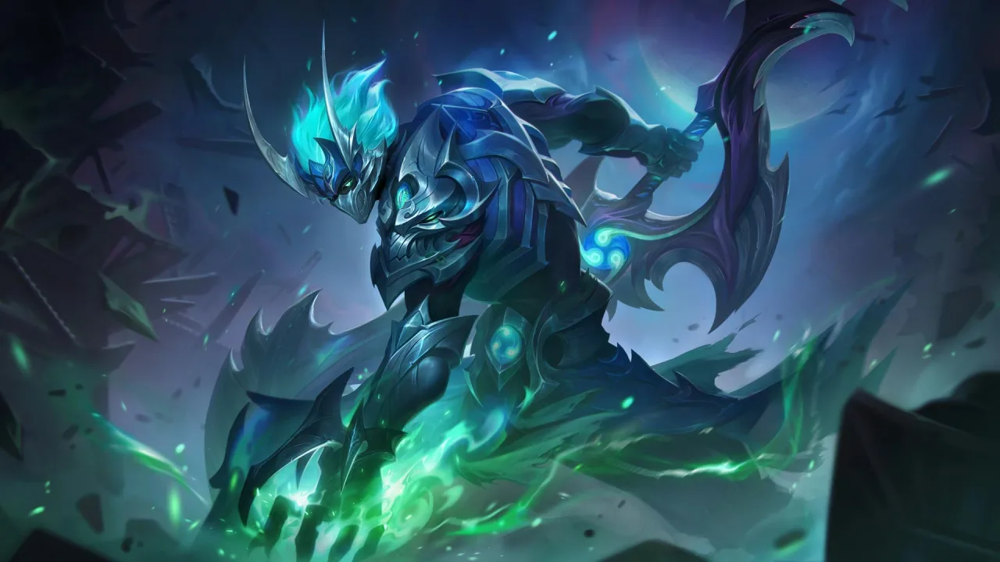

[Тир-лист](https://boostmlbb.ru/heroes/)[Предметы](https://boostmlbb.ru/items/)[Скины](https://boostmlbb.ru/skins/)[Новости и гайды](https://boostmlbb.ru/news/)

[Скины](https://boostmlbb.ru/skins/)/[Ханзо](https://boostmlbb.ru/skins/hanzo.html)/Бледный фантом

[Скин Ханзо](https://boostmlbb.ru/skins/hanzo.html)

# Бледный фантом

The Pale Phantom

Обычный CommonВ продаже

Как получить

Продаётся в магазине обликов за 269 алмазов.

Цена

269 алмазов

Вышел

22 февраля 2022

## Что меняет облик

-   Бонус к характеристикам

## Все скины Ханзо [5](https://boostmlbb.ru/skins/hanzo.html)

[Клыки резниИсключительный · 2026](https://boostmlbb.ru/skins/hanzo/fangs-of-slaughter.html)[Владыка преис­подней с огнём душиИзысканный · 2025](https://boostmlbb.ru/skins/hanzo/soulfire-netherlord.html)[Король нежитиОбычный · 2023](https://boostmlbb.ru/skins/hanzo/undead-king.html)[Бледный фантомОбычный · 2022](https://boostmlbb.ru/skins/hanzo/the-pale-phantom.html)[Коварный наставникИсключительный · 2020](https://boostmlbb.ru/skins/hanzo/insidious-tutor.html)

**Поднимем ранг на герое Ханзо**Цена считается в калькуляторе

[Рассчитать цену](https://boostmlbb.ru/order.html?type=hero)

## Частые вопросы

Как получить скин «Бледный фантом» на Ханзо?

Продаётся в магазине обликов за 269 алмазов.

Когда вышел скин «Бледный фантом»?

22 февраля 2022.

Какой класс у скина «Бледный фантом»?

Обычный (Common).
