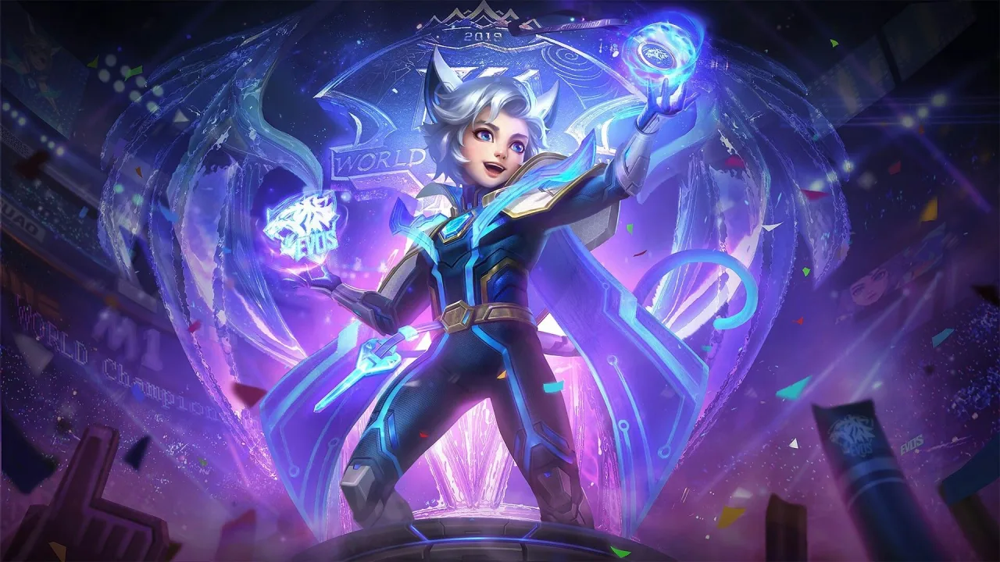
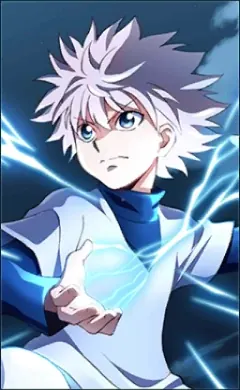
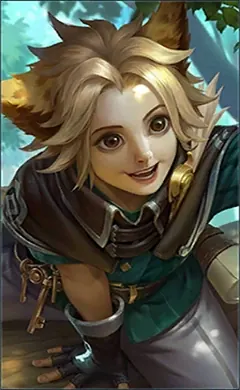

[Тир-лист](https://boostmlbb.ru/heroes/)[Предметы](https://boostmlbb.ru/items/)[Скины](https://boostmlbb.ru/skins/)[Новости и гайды](https://boostmlbb.ru/news/)

[Скины](https://boostmlbb.ru/skins/)/[Харит](https://boostmlbb.ru/skins/harith.html)/EVOS Legends

[Скин Харита](https://boostmlbb.ru/skins/harith.html)

# EVOS Legends

Делюкс DeluxeЧемпионскийОграниченный

Как получить

Киберспортивный облик (Чемпионский): выходил в событии турнира. Ограниченные облики иногда возвращаются в розыгрышах событий.

Вышел

3 апреля 2025

## Что меняет облик

-   Новая внешность
-   Новые эффекты навыков
-   Анимация показа
-   Сцена показа
-   Бонус к характеристикам

## Все скины Харита [8](https://boostmlbb.ru/skins/harith.html)

[EVOS LegendsДелюкс · 2025](https://boostmlbb.ru/skins/harith/evos-legends.html)[Рож­дественский карнавалИсключительный · 2025](https://boostmlbb.ru/skins/harith/christmas-carnival.html)[КиллуаГрандиозный · 2025](https://boostmlbb.ru/skins/harith/killua.html)[ЭкстрасенсИзысканный · 2024](https://boostmlbb.ru/skins/harith/psychic.html)[Знаток модыИсключительный · 2021](https://boostmlbb.ru/skins/harith/fashion-expert.html)[Рождённый светом: Вдохно­вительДелюкс · 2018](https://boostmlbb.ru/skins/harith/lightborn-inspirer.html)[Кот саванныОбычный · 2018](https://boostmlbb.ru/skins/harith/savannah-cat.html)[Звёздная пыльОбычный · 2018](https://boostmlbb.ru/skins/harith/stardust.html)

## Серия «Чемпионский»

[APBrenБроуди · 2024](https://boostmlbb.ru/skins/brody/apbren.html)[Blacklist Interna­tionalЭстес · 2024](https://boostmlbb.ru/skins/estes/blacklist-international.html)[ECHOЧу · 2023](https://boostmlbb.ru/skins/chou/echo.html)[Bren EsportsЛанселот · 2020](https://boostmlbb.ru/skins/lancelot/bren-esports.html)

**Поднимем ранг на герое Харит**Цена считается в калькуляторе

[Рассчитать цену](https://boostmlbb.ru/order.html?type=hero)

## Частые вопросы

Как получить скин «EVOS Legends» на Харита?

Киберспортивный облик (Чемпионский): выходил в событии турнира. Ограниченные облики иногда возвращаются в розыгрышах событий.

Когда вышел скин «EVOS Legends»?

3 апреля 2025.

Какой класс у скина «EVOS Legends»?

Делюкс (Deluxe), серия «Чемпионский».
