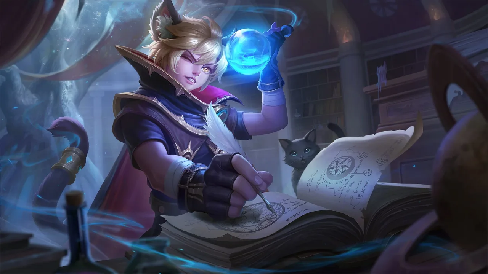
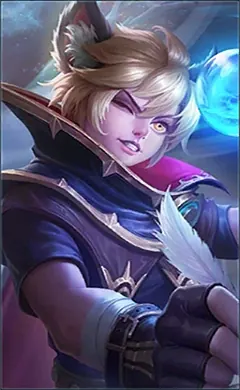

[Тир-лист](https://boostmlbb.ru/heroes/)[Предметы](https://boostmlbb.ru/items/)[Скины](https://boostmlbb.ru/skins/)[Новости и гайды](https://boostmlbb.ru/news/)

[Скины](https://boostmlbb.ru/skins/)/[Харит](https://boostmlbb.ru/skins/harith.html)/Звёздная пыль

[Скин Харита](https://boostmlbb.ru/skins/harith.html)

# Звёздная пыль

Stardust

Обычный CommonЭлитныйВ продаже

Как получить

Продаётся в магазине обликов за 599 алмазов.

Цена

599 алмазов

Вышел

1 марта 2018

## Что меняет облик

-   Новая внешность
-   Другой цвет эффектов
-   Анимация показа
-   Бонус к характеристикам

## Перекраски

Тот же облик в других цветах. Перекраска открывается, только если у вас уже есть сам облик.

-   **Путник** WayfarerНаграда «Звёздного участника» в мае 2022.

## Все скины Харита [8](https://boostmlbb.ru/skins/harith.html)

[EVOS LegendsДелюкс · 2025](https://boostmlbb.ru/skins/harith/evos-legends.html)[Рож­дественский карнавалИсключительный · 2025](https://boostmlbb.ru/skins/harith/christmas-carnival.html)[КиллуаГрандиозный · 2025](https://boostmlbb.ru/skins/harith/killua.html)[ЭкстрасенсИзысканный · 2024](https://boostmlbb.ru/skins/harith/psychic.html)[Знаток модыИсключительный · 2021](https://boostmlbb.ru/skins/harith/fashion-expert.html)[Рождённый светом: Вдохно­вительДелюкс · 2018](https://boostmlbb.ru/skins/harith/lightborn-inspirer.html)[Кот саванныОбычный · 2018](https://boostmlbb.ru/skins/harith/savannah-cat.html)[Звёздная пыльОбычный · 2018](https://boostmlbb.ru/skins/harith/stardust.html)

## Серия «Элитный»

[Золотой османтусЧан'Э · 2026](https://boostmlbb.ru/skins/change/golden-osmanthus.html)[Король-воена­чальникМартис · 2025](https://boostmlbb.ru/skins/martis/warlord-king.html)[Кадет открытого моряКимми · 2024](https://boostmlbb.ru/skins/kimmy/high-seas-cadet.html)[Зелёная копейщицаСильвана · 2024](https://boostmlbb.ru/skins/silvanna/verdant-lancer.html)[Мародёр Кровавое КопытоХилос · 2024](https://boostmlbb.ru/skins/hylos/bloodhoof-marauder.html)[Изящная бабочкаГвиневра · 2024](https://boostmlbb.ru/skins/guinevere/elegant-butterfly.html)[Маркиз клинковЛанселот · 2024](https://boostmlbb.ru/skins/lancelot/marques-of-blades.html)[Привал в пустошахЧип · 2024](https://boostmlbb.ru/skins/chip/badlands-hiatus.html)

**Поднимем ранг на герое Харит**Цена считается в калькуляторе

[Рассчитать цену](https://boostmlbb.ru/order.html?type=hero)

## Частые вопросы

Как получить скин «Звёздная пыль» на Харита?

Продаётся в магазине обликов за 599 алмазов.

Когда вышел скин «Звёздная пыль»?

1 марта 2018.

Какой класс у скина «Звёздная пыль»?

Обычный (Common), серия «Элитный».
