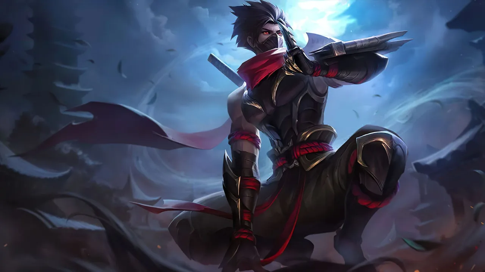

[Тир-лист](https://boostmlbb.ru/heroes/)[Предметы](https://boostmlbb.ru/items/)[Скины](https://boostmlbb.ru/skins/)[Новости и гайды](https://boostmlbb.ru/news/)

[Скины](https://boostmlbb.ru/skins/)/Хаябуса

# Скины Хаябусы

Скинов

11

Можно купить

3

Последний

[Тень кицунэ](https://boostmlbb.ru/skins/hayabusa/kitsune-s-shadow.html)2026

[Профиль героя→](https://boostmlbb.ru/heroes/hayabusa.html)

## Все скины

ВсеГрандиозныйИзысканныйИсключительныйОбычный

[Тень кицунэИсключительный · 2026](https://boostmlbb.ru/skins/hayabusa/kitsune-s-shadow.html)[Какаши ХатакеГрандиозный · 2025](https://boostmlbb.ru/skins/hayabusa/kakashi-hatake.html)[Экзорцист ХаябусаГрандиозный · 2024](https://boostmlbb.ru/skins/hayabusa/exorcist-hayabusa.html)[Ниндзя-технарьОбычный · 2022](https://boostmlbb.ru/skins/hayabusa/techie-ninja.html)[ШураГрандиозный · 2021](https://boostmlbb.ru/skins/hayabusa/shura.html)[Биологи­ческое оружиеИсключительный · 2020](https://boostmlbb.ru/skins/hayabusa/biological-weapon.html)[Тень без­вестностиИзысканный · 2019](https://boostmlbb.ru/skins/hayabusa/shadow-of-obscurity.html)[Мастер сушиИсключительный · 2019](https://boostmlbb.ru/skins/hayabusa/sushi-master.html)[Экспе­римент 21Изысканный · 2018](https://boostmlbb.ru/skins/hayabusa/experiment-21.html)[Страж будущегоОбычный · 2017](https://boostmlbb.ru/skins/hayabusa/future-enforcer.html)[Тень пространства-времениОбычный · 2016](https://boostmlbb.ru/skins/hayabusa/spacetime-shadow.html)

**Поднимем ранг на герое Хаябуса**Цена считается в калькуляторе

[Рассчитать цену](https://boostmlbb.ru/order.html?type=hero)

## Частые вопросы

Сколько скинов у Хаябусы?

11 скинов без стандартного облика. Последний — «Тень кицунэ» (Kitsune's Shadow), 1 октября 2026.

Какие скины Хаябусы можно купить сейчас?

«Мастер суши» (749 алмазов), «Страж будущего» (599 алмазов), «Тень пространства-времени» (269 алмазов). Остальные облики ограниченные и возвращаются только в событиях.

Какой самый редкий скин Хаябусы?

«Какаши Хатаке» (Kakashi Hatake), класс грандиозный, серия «Наруто». Выходил в событии коллаборации MLBB × Наруто. Ограниченные облики иногда возвращаются в розыгрышах событий.
