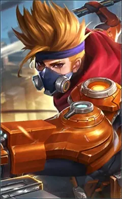

[Скины Хаябусы](https://boostmlbb.ru/skins/hayabusa.html)

[Скины](https://boostmlbb.ru/skins/)/[Хаябуса](https://boostmlbb.ru/skins/hayabusa.html)/Биологическое оружие

[Скин Хаябусы](https://boostmlbb.ru/skins/hayabusa.html)

# Биологическое оружие

Biological Weapon

Исключительный ExceptionalЗвёздный участникОграниченный

Как получить

Награда «Звёздного участника» в июле 2020.

Вышел

1 июля 2020

## Что меняет облик

-   Новая внешность
-   Новые эффекты навыков
-   Анимация показа
-   Сцена показа
-   Бонус к характеристикам

## Все скины Хаябусы [11](https://boostmlbb.ru/skins/hayabusa.html)

[Тень кицунэИсключительный · 2026](https://boostmlbb.ru/skins/hayabusa/kitsune-s-shadow.html)[Какаши ХатакеГрандиозный · 2025](https://boostmlbb.ru/skins/hayabusa/kakashi-hatake.html)[Экзорцист ХаябусаГрандиозный · 2024](https://boostmlbb.ru/skins/hayabusa/exorcist-hayabusa.html)[Ниндзя-технарьОбычный · 2022](https://boostmlbb.ru/skins/hayabusa/techie-ninja.html)[ШураГрандиозный · 2021](https://boostmlbb.ru/skins/hayabusa/shura.html)[Биологи­ческое оружиеИсключительный · 2020](https://boostmlbb.ru/skins/hayabusa/biological-weapon.html)[Тень без­вестностиИзысканный · 2019](https://boostmlbb.ru/skins/hayabusa/shadow-of-obscurity.html)[Мастер сушиИсключительный · 2019](https://boostmlbb.ru/skins/hayabusa/sushi-master.html)[Экспе­римент 21Изысканный · 2018](https://boostmlbb.ru/skins/hayabusa/experiment-21.html)[Страж будущегоОбычный · 2017](https://boostmlbb.ru/skins/hayabusa/future-enforcer.html)[Тень пространства-времениОбычный · 2016](https://boostmlbb.ru/skins/hayabusa/spacetime-shadow.html)

## Серия «Звёздный участник»

[Морячка, рождённая приливомКалеа · 2026](https://boostmlbb.ru/skins/kalea/tideborn-sailor.html)[Тень кицунэХаябуса · 2026](https://boostmlbb.ru/skins/hayabusa/kitsune-s-shadow.html)[Клыки резниХанзо · 2026](https://boostmlbb.ru/skins/hanzo/fangs-of-slaughter.html)[Тлеющая крепостьБелерик · 2026](https://boostmlbb.ru/skins/belerick/smouldering-fortress.html)[Магитех­нический призракОбсидия · 2026](https://boostmlbb.ru/skins/obsidia/magitech-wraith.html)[Элизийское сияниеЦзэтянь · 2026](https://boostmlbb.ru/skins/zetian/elysian-luminance.html)[Батальон стражейХильда · 2026](https://boostmlbb.ru/skins/hilda/guardian-battalion.html)[Мечта­тельный коиХарли · 2026](https://boostmlbb.ru/skins/harley/dreaming-koi.html)

**Сколько стоит буст на герое Хаябуса?**Выберите текущий и желаемый ранг. Стоимость появится на сайте.

[Рассчитать цену](https://boostmlbb.ru/order.html?type=hero)

## Частые вопросы

Как получить скин «Биологическое оружие» на Хаябусу?

Награда «Звёздного участника» в июле 2020.

Когда вышел скин «Биологическое оружие»?

1 июля 2020.

Какой класс у скина «Биологическое оружие»?

Исключительный (Exceptional), серия «Звёздный участник».
