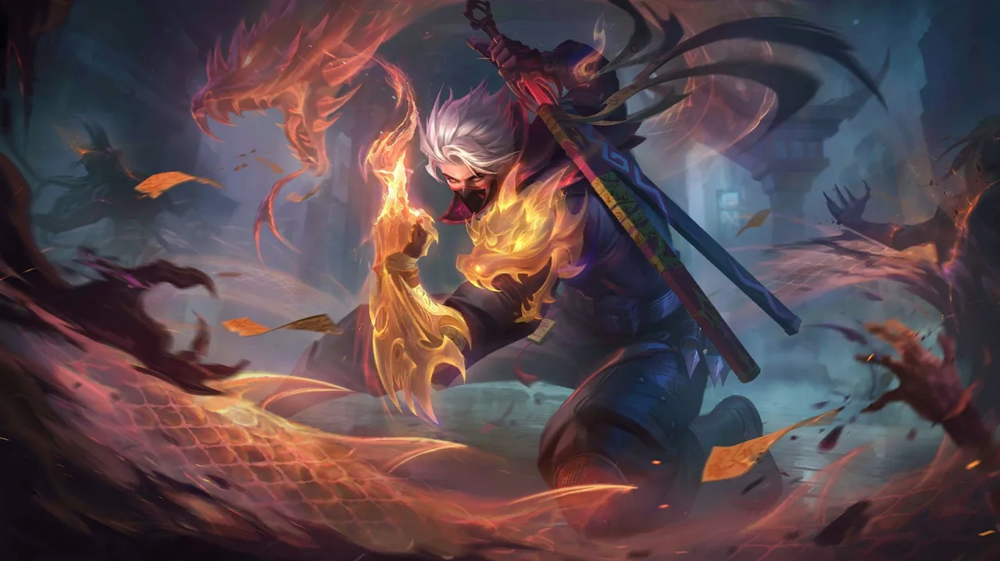

[Тир-лист](https://boostmlbb.ru/heroes/)[Предметы](https://boostmlbb.ru/items/)[Скины](https://boostmlbb.ru/skins/)[Новости и гайды](https://boostmlbb.ru/news/)

[Скины](https://boostmlbb.ru/skins/)/[Хаябуса](https://boostmlbb.ru/skins/hayabusa.html)/Экзорцист Хаябуса

[Скин Хаябусы](https://boostmlbb.ru/skins/hayabusa.html)

# Экзорцист Хаябуса

Exorcist Hayabusa

Грандиозный GrandЭкзорцистыОграниченный

Как получить

Выходил в событии «Экзорцисты». Ограниченные облики иногда возвращаются в розыгрышах событий.

Вышел

май 2024

## Что меняет облик

-   Новая внешность
-   Новые эффекты навыков
-   Звуки навыков
-   Своя озвучка
-   Иконки навыков
-   Анимация показа
-   Сцена показа
-   Музыка показа
-   Анимация появления
-   Особые действия
-   Бонус к характеристикам

## Все скины Хаябусы [11](https://boostmlbb.ru/skins/hayabusa.html)

[Тень кицунэИсключительный · 2026](https://boostmlbb.ru/skins/hayabusa/kitsune-s-shadow.html)[Какаши ХатакеГрандиозный · 2025](https://boostmlbb.ru/skins/hayabusa/kakashi-hatake.html)[Экзорцист ХаябусаГрандиозный · 2024](https://boostmlbb.ru/skins/hayabusa/exorcist-hayabusa.html)[Ниндзя-технарьОбычный · 2022](https://boostmlbb.ru/skins/hayabusa/techie-ninja.html)[ШураГрандиозный · 2021](https://boostmlbb.ru/skins/hayabusa/shura.html)[Биологи­ческое оружиеИсключительный · 2020](https://boostmlbb.ru/skins/hayabusa/biological-weapon.html)[Тень без­вестностиИзысканный · 2019](https://boostmlbb.ru/skins/hayabusa/shadow-of-obscurity.html)[Мастер сушиИсключительный · 2019](https://boostmlbb.ru/skins/hayabusa/sushi-master.html)[Экспе­римент 21Изысканный · 2018](https://boostmlbb.ru/skins/hayabusa/experiment-21.html)[Страж будущегоОбычный · 2017](https://boostmlbb.ru/skins/hayabusa/future-enforcer.html)[Тень пространства-времениОбычный · 2016](https://boostmlbb.ru/skins/hayabusa/spacetime-shadow.html)

## Серия «Экзорцисты»

[Экзорцист ГрейнджерГрейнджер · 2023](https://boostmlbb.ru/skins/granger/exorcist-granger.html)[Экзорцист ЧонгЧонг · 2022](https://boostmlbb.ru/skins/yu-zhong/exorcist-yu-zhong.html)[Экзор­цистка КагураКагура · 2022](https://boostmlbb.ru/skins/kagura/exorcist-kagura.html)

**Поднимем ранг на герое Хаябуса**Цена считается в калькуляторе

[Рассчитать цену](https://boostmlbb.ru/order.html?type=hero)

## Частые вопросы

Как получить скин «Экзорцист Хаябуса» на Хаябусу?

Выходил в событии «Экзорцисты». Ограниченные облики иногда возвращаются в розыгрышах событий.

Когда вышел скин «Экзорцист Хаябуса»?

Май 2024.

Какой класс у скина «Экзорцист Хаябуса»?

Грандиозный (Grand), серия «Экзорцисты».
