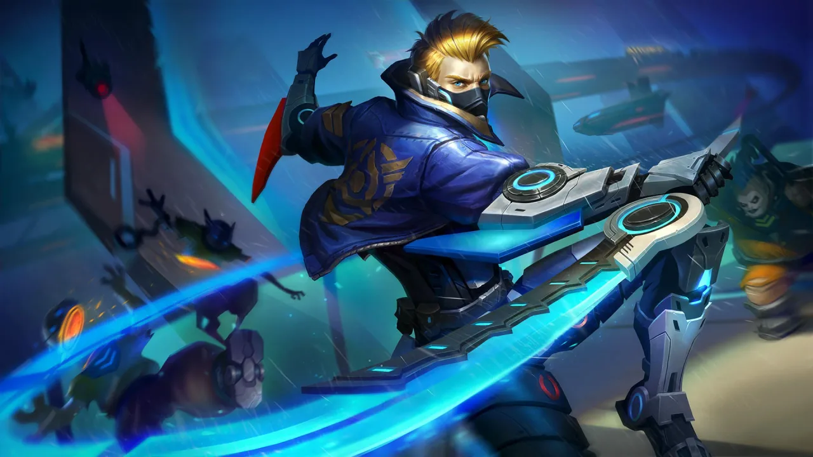

[Тир-лист](https://boostmlbb.ru/heroes/)[Предметы](https://boostmlbb.ru/items/)[Скины](https://boostmlbb.ru/skins/)[Новости и гайды](https://boostmlbb.ru/news/)

[Скины](https://boostmlbb.ru/skins/)/[Хаябуса](https://boostmlbb.ru/skins/hayabusa.html)/Страж будущего

[Скин Хаябусы](https://boostmlbb.ru/skins/hayabusa.html)

# Страж будущего

Future Enforcer

Обычный CommonЭлитныйВ продаже

Как получить

Продаётся в магазине обликов за 599 алмазов.

Цена

599 алмазов

Вышел

2017 год

## Что меняет облик

-   Новая внешность
-   Другой цвет эффектов
-   Анимация показа
-   Бонус к характеристикам

## Перекраски

Тот же облик в других цветах. Перекраска открывается, только если у вас уже есть сам облик.

-   **Страж будущего: Железо** Future Enforcer - Iron188 алмазов

## Все скины Хаябусы [11](https://boostmlbb.ru/skins/hayabusa.html)

[Тень кицунэИсключительный · 2026](https://boostmlbb.ru/skins/hayabusa/kitsune-s-shadow.html)[Какаши ХатакеГрандиозный · 2025](https://boostmlbb.ru/skins/hayabusa/kakashi-hatake.html)[Экзорцист ХаябусаГрандиозный · 2024](https://boostmlbb.ru/skins/hayabusa/exorcist-hayabusa.html)[Ниндзя-технарьОбычный · 2022](https://boostmlbb.ru/skins/hayabusa/techie-ninja.html)[ШураГрандиозный · 2021](https://boostmlbb.ru/skins/hayabusa/shura.html)[Биологи­ческое оружиеИсключительный · 2020](https://boostmlbb.ru/skins/hayabusa/biological-weapon.html)[Тень без­вестностиИзысканный · 2019](https://boostmlbb.ru/skins/hayabusa/shadow-of-obscurity.html)[Мастер сушиИсключительный · 2019](https://boostmlbb.ru/skins/hayabusa/sushi-master.html)[Экспе­римент 21Изысканный · 2018](https://boostmlbb.ru/skins/hayabusa/experiment-21.html)[Страж будущегоОбычный · 2017](https://boostmlbb.ru/skins/hayabusa/future-enforcer.html)[Тень пространства-времениОбычный · 2016](https://boostmlbb.ru/skins/hayabusa/spacetime-shadow.html)

## Серия «Элитный»

[Золотой османтусЧан'Э · 2026](https://boostmlbb.ru/skins/change/golden-osmanthus.html)[Король-воена­чальникМартис · 2025](https://boostmlbb.ru/skins/martis/warlord-king.html)[Кадет открытого моряКимми · 2024](https://boostmlbb.ru/skins/kimmy/high-seas-cadet.html)[Зелёная копейщицаСильвана · 2024](https://boostmlbb.ru/skins/silvanna/verdant-lancer.html)[Мародёр Кровавое КопытоХилос · 2024](https://boostmlbb.ru/skins/hylos/bloodhoof-marauder.html)[Изящная бабочкаГвиневра · 2024](https://boostmlbb.ru/skins/guinevere/elegant-butterfly.html)[Маркиз клинковЛанселот · 2024](https://boostmlbb.ru/skins/lancelot/marques-of-blades.html)[Привал в пустошахЧип · 2024](https://boostmlbb.ru/skins/chip/badlands-hiatus.html)

**Поднимем ранг на герое Хаябуса**Цена считается в калькуляторе

[Рассчитать цену](https://boostmlbb.ru/order.html?type=hero)

## Частые вопросы

Как получить скин «Страж будущего» на Хаябусу?

Продаётся в магазине обликов за 599 алмазов.

Когда вышел скин «Страж будущего»?

2017 год.

Какой класс у скина «Страж будущего»?

Обычный (Common), серия «Элитный».
