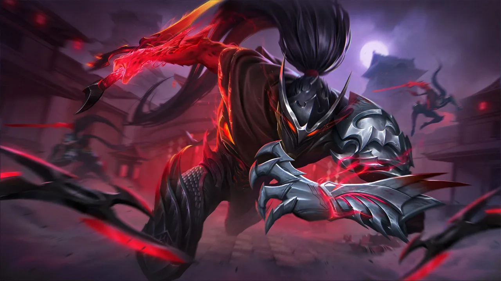
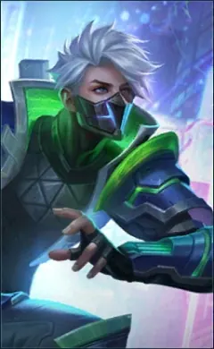

[Скины Хаябусы](https://boostmlbb.ru/skins/hayabusa.html)

[Скины](https://boostmlbb.ru/skins/)/[Хаябуса](https://boostmlbb.ru/skins/hayabusa.html)/Тень безвестности

[Скин Хаябусы](https://boostmlbb.ru/skins/hayabusa.html)

# Тень безвестности

Shadow of Obscurity

Изысканный ExquisiteЯщик удачиОграниченный

Как получить

Выпадал из ящиков удачи в событиях. Ограниченные облики иногда возвращаются в розыгрышах событий.

Вышел

октябрь 2019

## Что меняет облик

-   Новая внешность
-   Новые эффекты навыков
-   Звуки навыков
-   Своя озвучка
-   Анимация показа
-   Сцена показа
-   Бонус к характеристикам

## Все скины Хаябусы [11](https://boostmlbb.ru/skins/hayabusa.html)

[Тень кицунэИсключительный · 2026](https://boostmlbb.ru/skins/hayabusa/kitsune-s-shadow.html)[Какаши ХатакеГрандиозный · 2025](https://boostmlbb.ru/skins/hayabusa/kakashi-hatake.html)[Экзорцист ХаябусаГрандиозный · 2024](https://boostmlbb.ru/skins/hayabusa/exorcist-hayabusa.html)[Ниндзя-технарьОбычный · 2022](https://boostmlbb.ru/skins/hayabusa/techie-ninja.html)[ШураГрандиозный · 2021](https://boostmlbb.ru/skins/hayabusa/shura.html)[Биологи­ческое оружиеИсключительный · 2020](https://boostmlbb.ru/skins/hayabusa/biological-weapon.html)[Тень без­вестностиИзысканный · 2019](https://boostmlbb.ru/skins/hayabusa/shadow-of-obscurity.html)[Мастер сушиИсключительный · 2019](https://boostmlbb.ru/skins/hayabusa/sushi-master.html)[Экспе­римент 21Изысканный · 2018](https://boostmlbb.ru/skins/hayabusa/experiment-21.html)[Страж будущегоОбычный · 2017](https://boostmlbb.ru/skins/hayabusa/future-enforcer.html)[Тень пространства-времениОбычный · 2016](https://boostmlbb.ru/skins/hayabusa/spacetime-shadow.html)

## Серия «Ящик удачи»

[Леди-журавльГвиневра · 2025](https://boostmlbb.ru/skins/guinevere/lady-crane.html)[Серафим-бабочкаЛюнокс · 2025](https://boostmlbb.ru/skins/lunox/butterfly-seraphim.html)[МехадраконКлауд · 2025](https://boostmlbb.ru/skins/claude/mecha-dragon.html)[Лунная магияЧан'Э · 2020](https://boostmlbb.ru/skins/change/lunar-magic.html)[Громовая вспышкаСелена · 2020](https://boostmlbb.ru/skins/selena/thunder-flash.html)[РакшасаХанаби · 2020](https://boostmlbb.ru/skins/hanabi/rakshesha.html)[Повелитель видеоигрУранус · 2020](https://boostmlbb.ru/skins/uranus/video-game-dominator.html)[Бог войныМартис · 2020](https://boostmlbb.ru/skins/martis/god-of-war.html)

**Сколько стоит буст на герое Хаябуса?**Выберите текущий и желаемый ранг. Стоимость появится на сайте.

[Рассчитать цену](https://boostmlbb.ru/order.html?type=hero)

## Частые вопросы

Как получить скин «Тень безвестности» на Хаябусу?

Выпадал из ящиков удачи в событиях. Ограниченные облики иногда возвращаются в розыгрышах событий.

Когда вышел скин «Тень безвестности»?

Октябрь 2019.

Какой класс у скина «Тень безвестности»?

Изысканный (Exquisite), серия «Ящик удачи».
