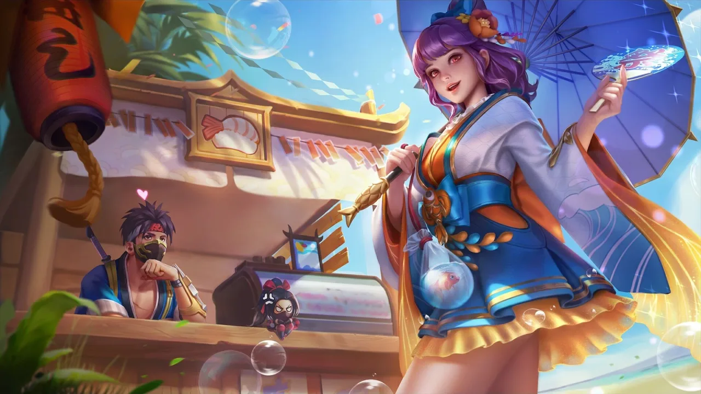

[Тир-лист](https://boostmlbb.ru/heroes/)[Предметы](https://boostmlbb.ru/items/)[Скины](https://boostmlbb.ru/skins/)[Новости и гайды](https://boostmlbb.ru/news/)

[Скины](https://boostmlbb.ru/skins/)/[Хаябуса](https://boostmlbb.ru/skins/hayabusa.html)/Мастер суши

[Скин Хаябусы](https://boostmlbb.ru/skins/hayabusa.html)

# Мастер суши

Sushi Master

Исключительный ExceptionalЛетнийВ продаже

Как получить

Продаётся в магазине обликов за 749 алмазов.

Цена

749 алмазов

Вышел

2019 год

## Что меняет облик

-   Новая внешность
-   Новые эффекты навыков
-   Анимация показа
-   Сцена показа
-   Бонус к характеристикам

## Перекраски

Тот же облик в других цветах. Перекраска открывается, только если у вас уже есть сам облик.

-   **Мастер суши: Фиолетовый** Sushi Master - Purple188 алмазов

## Все скины Хаябусы [11](https://boostmlbb.ru/skins/hayabusa.html)

[Тень кицунэИсключительный · 2026](https://boostmlbb.ru/skins/hayabusa/kitsune-s-shadow.html)[Какаши ХатакеГрандиозный · 2025](https://boostmlbb.ru/skins/hayabusa/kakashi-hatake.html)[Экзорцист ХаябусаГрандиозный · 2024](https://boostmlbb.ru/skins/hayabusa/exorcist-hayabusa.html)[Ниндзя-технарьОбычный · 2022](https://boostmlbb.ru/skins/hayabusa/techie-ninja.html)[ШураГрандиозный · 2021](https://boostmlbb.ru/skins/hayabusa/shura.html)[Биологи­ческое оружиеИсключительный · 2020](https://boostmlbb.ru/skins/hayabusa/biological-weapon.html)[Тень без­вестностиИзысканный · 2019](https://boostmlbb.ru/skins/hayabusa/shadow-of-obscurity.html)[Мастер сушиИсключительный · 2019](https://boostmlbb.ru/skins/hayabusa/sushi-master.html)[Экспе­римент 21Изысканный · 2018](https://boostmlbb.ru/skins/hayabusa/experiment-21.html)[Страж будущегоОбычный · 2017](https://boostmlbb.ru/skins/hayabusa/future-enforcer.html)[Тень пространства-времениОбычный · 2016](https://boostmlbb.ru/skins/hayabusa/spacetime-shadow.html)

## Серия «Летний»

[Летние брызгиВанван · 2025](https://boostmlbb.ru/skins/wanwan/summer-splash.html)[Официантка ятайФлорин · 2024](https://boostmlbb.ru/skins/floryn/yatai-waitress.html)[Летний бризГвиневра · 2024](https://boostmlbb.ru/skins/guinevere/summer-breeze.html)[Спаса­тельницаКлауд · 2024](https://boostmlbb.ru/skins/claude/lifeguard.html)[Летние волныЗилонг · 2020](https://boostmlbb.ru/skins/zilong/summer-waves.html)[Летнее настроениеАнгела · 2019](https://boostmlbb.ru/skins/angela/summer-vibes.html)[Летнее платьеНана · 2019](https://boostmlbb.ru/skins/nana/sundress.html)[Летний фестивальКагура · 2019](https://boostmlbb.ru/skins/kagura/summer-festival.html)

**Поднимем ранг на герое Хаябуса**Цена считается в калькуляторе

[Рассчитать цену](https://boostmlbb.ru/order.html?type=hero)

## Частые вопросы

Как получить скин «Мастер суши» на Хаябусу?

Продаётся в магазине обликов за 749 алмазов.

Когда вышел скин «Мастер суши»?

2019 год.

Какой класс у скина «Мастер суши»?

Исключительный (Exceptional), серия «Летний».
