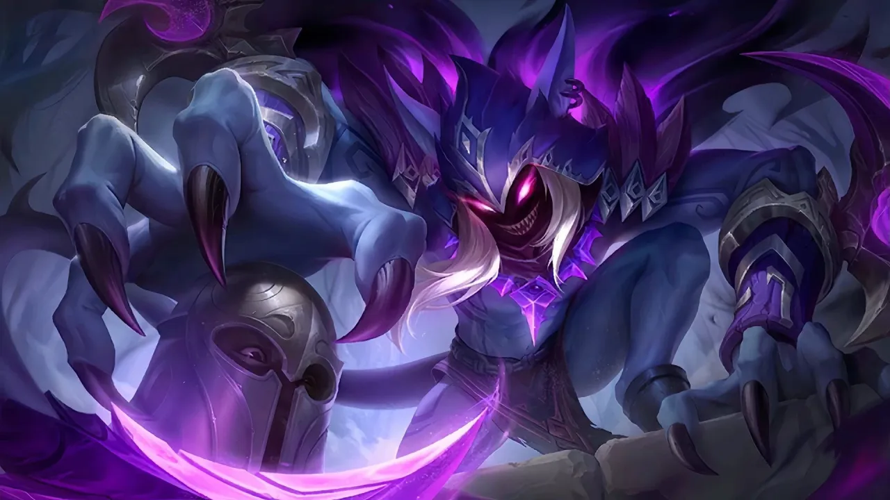
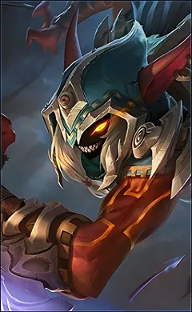

[Все скины](https://boostmlbb.ru/skins/)

[Скины](https://boostmlbb.ru/skins/)/Хелкарт

# Скины Хелкарта

Скинов

6

Можно купить

2

Последний

[Кайдзю глубин](https://boostmlbb.ru/skins/helcurt/kaiju-of-the-deep.html)2026

[Профиль героя→](https://boostmlbb.ru/heroes/helcurt.html)

## Все скины

[Кайдзю глубинИзысканный · 2026](https://boostmlbb.ru/skins/helcurt/kaiju-of-the-deep.html)[Хищник сновИсключительный · 2024](https://boostmlbb.ru/skins/helcurt/dream-prowler.html)[СкорпионДелюкс · 2019](https://boostmlbb.ru/skins/helcurt/scorpio.html)[Эволюциони­ровавший хищникИсключительный · 2018](https://boostmlbb.ru/skins/helcurt/evolved-predator.html)[Ледяная косаОбычный · 2018](https://boostmlbb.ru/skins/helcurt/ice-scythe.html)[Палач-чужакОбычный · 2017](https://boostmlbb.ru/skins/helcurt/exoracial-executer.html)

**Сколько стоит буст на герое Хелкарт?**Выберите текущий и желаемый ранг. Стоимость появится на сайте.

[Рассчитать цену](https://boostmlbb.ru/order.html?type=hero)

## Частые вопросы

Сколько скинов у Хелкарта?

6 скинов без стандартного облика. Последний — «Кайдзю глубин» (Kaiju of the Deep), июль 2026.

Какие скины Хелкарта можно купить сейчас?

«Эволюционировавший хищник» (749 алмазов), «Палач-чужак» (269 алмазов). Остальные облики ограниченные и возвращаются только в событиях.

Какой самый редкий скин Хелкарта?

«Кайдзю глубин» (Kaiju of the Deep), класс изысканный, серия «Коллекционный». Главный приз розыгрыша в коллекционном событии, попытки покупаются за алмазы. Ограниченные облики иногда возвращаются в розыгрышах событий.
