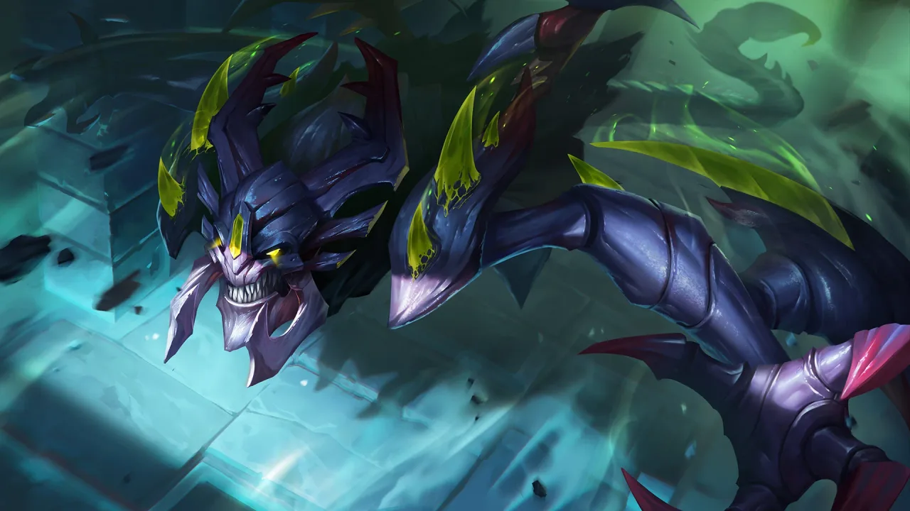

[Тир-лист](https://boostmlbb.ru/heroes/)[Предметы](https://boostmlbb.ru/items/)[Скины](https://boostmlbb.ru/skins/)[Новости и гайды](https://boostmlbb.ru/news/)

[Скины](https://boostmlbb.ru/skins/)/[Хелкарт](https://boostmlbb.ru/skins/helcurt.html)/Эволюционировавший хищник

[Скин Хелкарта](https://boostmlbb.ru/skins/helcurt.html)

# Эволюционировавший хищник

Evolved Predator

Исключительный ExceptionalОсобыйВ продаже

Как получить

Продаётся в магазине обликов за 749 алмазов.

Цена

749 алмазов

Вышел

2 июня 2018

## Что меняет облик

-   Новая внешность
-   Новые эффекты навыков
-   Анимация показа
-   Бонус к характеристикам

## Перекраски

Тот же облик в других цветах. Перекраска открывается, только если у вас уже есть сам облик.

-   **Смертельное жало** Fatal StingerНаграда «Звёздного участника» в июне 2021.

## Все скины Хелкарта [6](https://boostmlbb.ru/skins/helcurt.html)

[Кайдзю глубинИзысканный · 2026](https://boostmlbb.ru/skins/helcurt/kaiju-of-the-deep.html)[Хищник сновИсключительный · 2024](https://boostmlbb.ru/skins/helcurt/dream-prowler.html)[СкорпионДелюкс · 2019](https://boostmlbb.ru/skins/helcurt/scorpio.html)[Эволюциони­ровавший хищникИсключительный · 2018](https://boostmlbb.ru/skins/helcurt/evolved-predator.html)[Ледяная косаОбычный · 2018](https://boostmlbb.ru/skins/helcurt/ice-scythe.html)[Палач-чужакОбычный · 2017](https://boostmlbb.ru/skins/helcurt/exoracial-executer.html)

## Серия «Особый»

[Тайный вердиктМатильда · 2026](https://boostmlbb.ru/skins/mathilda/arcane-verdict.html)[Вальс на ветруВэйл · 2026](https://boostmlbb.ru/skins/vale/windborne-waltz.html)[Капитан потерянныхФранко · 2026](https://boostmlbb.ru/skins/franco/captain-of-the-lost.html)[ВолнорезЛи Сун-Син · 2025](https://boostmlbb.ru/skins/yi-sun-shin/wavebreaker.html)[Стальные рукиБаданг · 2025](https://boostmlbb.ru/skins/badang/steel-arms.html)[Леди с зонтикомКагура · 2025](https://boostmlbb.ru/skins/kagura/lady-parasol.html)[Ужас пучиныАлдос · 2025](https://boostmlbb.ru/skins/aldous/fathom-terror.html)[Труппа лунного светаЧан'Э · 2025](https://boostmlbb.ru/skins/change/moonglow-troupe.html)

**Поднимем ранг на герое Хелкарт**Цена считается в калькуляторе

[Рассчитать цену](https://boostmlbb.ru/order.html?type=hero)

## Частые вопросы

Как получить скин «Эволюционировавший хищник» на Хелкарта?

Продаётся в магазине обликов за 749 алмазов.

Когда вышел скин «Эволюционировавший хищник»?

2 июня 2018.

Какой класс у скина «Эволюционировавший хищник»?

Исключительный (Exceptional), серия «Особый».
