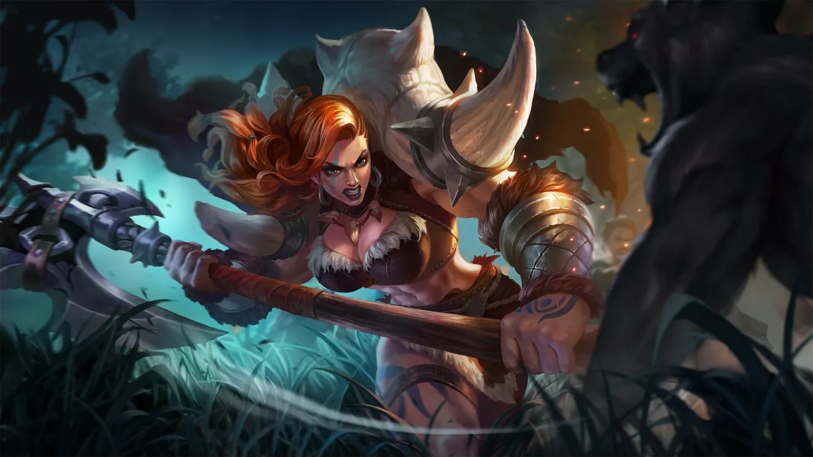

[Тир-лист](https://boostmlbb.ru/heroes/)[Предметы](https://boostmlbb.ru/items/)[Скины](https://boostmlbb.ru/skins/)[Новости и гайды](https://boostmlbb.ru/news/)

[Скины](https://boostmlbb.ru/skins/)/Хильда

# Скины Хильды

Скинов

6

Можно купить

2

Последний

[Батальон стражей](https://boostmlbb.ru/skins/hilda/guardian-battalion.html)2026

[Профиль героя→](https://boostmlbb.ru/heroes/hilda.html)

## Все скины

[Батальон стражей2026](https://boostmlbb.ru/skins/hilda/guardian-battalion.html)[Басовое безумиеИсключительный · 2021](https://boostmlbb.ru/skins/hilda/bass-craze.html)[ОвенДелюкс · 2019](https://boostmlbb.ru/skins/hilda/aries.html)[Священная стражаОбычный · 2018](https://boostmlbb.ru/skins/hilda/sacred-guard.html)[Цветок пустошейОбычный · 2017](https://boostmlbb.ru/skins/hilda/flower-of-the-wastes.html)[Сила дикой природыОбычный · 2017](https://boostmlbb.ru/skins/hilda/power-of-wildness.html)

**Поднимем ранг на герое Хильда**Цена считается в калькуляторе

[Рассчитать цену](https://boostmlbb.ru/order.html?type=hero)

## Частые вопросы

Сколько скинов у Хильды?

6 скинов без стандартного облика. Последний — «Батальон стражей» (Guardian Battalion), февраль 2026.

Какие скины Хильды можно купить сейчас?

«Басовое безумие» (749 алмазов), «Сила дикой природы» (269 алмазов). Остальные облики ограниченные и возвращаются только в событиях.

Какой самый редкий скин Хильды?

«Овен» (Aries), класс делюкс, серия «Зодиак». Выпадает в розыгрыше «Зодиак» (Zodiac Summon).
