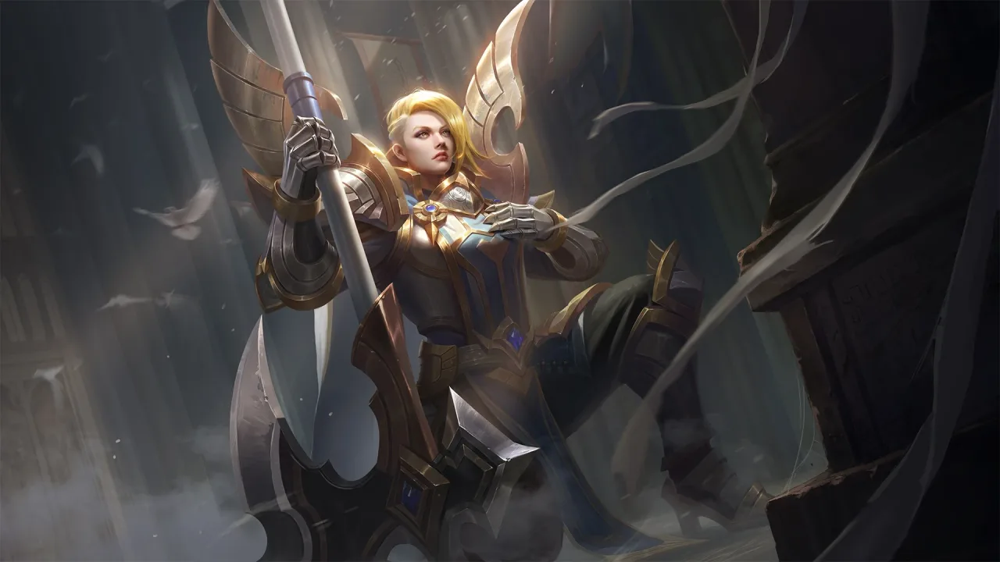

[Скины Хильды](https://boostmlbb.ru/skins/hilda.html)

[Скины](https://boostmlbb.ru/skins/)/[Хильда](https://boostmlbb.ru/skins/hilda.html)/Священная стража

[Скин Хильды](https://boostmlbb.ru/skins/hilda.html)

# Священная стража

Sacred Guard

Обычный CommonЭлитныйОграниченный

Как получить

Награда программы наставников.

Вышел

2018 год

## Что меняет облик

-   Новая внешность
-   Другой цвет эффектов
-   Анимация показа
-   Бонус к характеристикам

## Все скины Хильды [6](https://boostmlbb.ru/skins/hilda.html)

[Батальон стражей2026](https://boostmlbb.ru/skins/hilda/guardian-battalion.html)[Басовое безумиеИсключительный · 2021](https://boostmlbb.ru/skins/hilda/bass-craze.html)[ОвенДелюкс · 2019](https://boostmlbb.ru/skins/hilda/aries.html)[Священная стражаОбычный · 2018](https://boostmlbb.ru/skins/hilda/sacred-guard.html)[Цветок пустошейОбычный · 2017](https://boostmlbb.ru/skins/hilda/flower-of-the-wastes.html)[Сила дикой природыОбычный · 2017](https://boostmlbb.ru/skins/hilda/power-of-wildness.html)

## Серия «Элитный»

[Золотой османтусЧан'Э · 2026](https://boostmlbb.ru/skins/change/golden-osmanthus.html)[Король-воена­чальникМартис · 2025](https://boostmlbb.ru/skins/martis/warlord-king.html)[Кадет открытого моряКимми · 2024](https://boostmlbb.ru/skins/kimmy/high-seas-cadet.html)[Зелёная копейщицаСильвана · 2024](https://boostmlbb.ru/skins/silvanna/verdant-lancer.html)[Мародёр Кровавое КопытоХилос · 2024](https://boostmlbb.ru/skins/hylos/bloodhoof-marauder.html)[Изящная бабочкаГвиневра · 2024](https://boostmlbb.ru/skins/guinevere/elegant-butterfly.html)[Маркиз клинковЛанселот · 2024](https://boostmlbb.ru/skins/lancelot/marques-of-blades.html)[Привал в пустошахЧип · 2024](https://boostmlbb.ru/skins/chip/badlands-hiatus.html)

**Сколько стоит буст на герое Хильда?**Выберите текущий и желаемый ранг. Стоимость появится на сайте.

[Рассчитать цену](https://boostmlbb.ru/order.html?type=hero)

## Частые вопросы

Как получить скин «Священная стража» на Хильду?

Награда программы наставников.

Когда вышел скин «Священная стража»?

2018 год.

Какой класс у скина «Священная стража»?

Обычный (Common), серия «Элитный».
