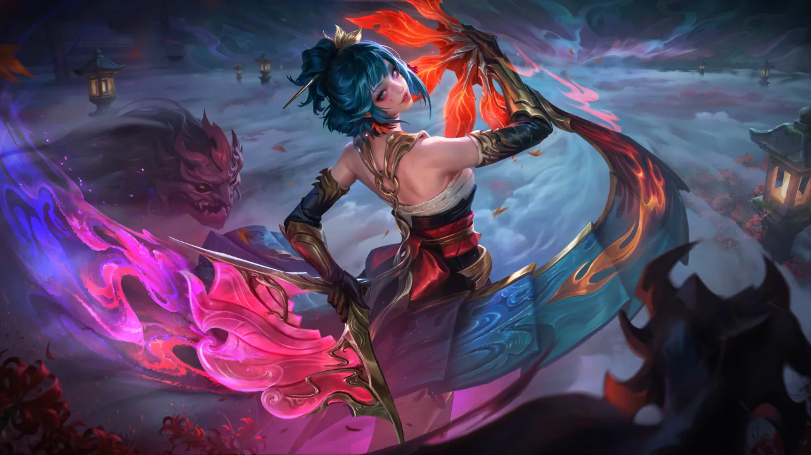
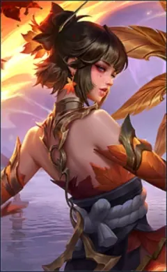

[Тир-лист](https://boostmlbb.ru/heroes/)[Предметы](https://boostmlbb.ru/items/)[Скины](https://boostmlbb.ru/skins/)[Новости и гайды](https://boostmlbb.ru/news/)

[Скины](https://boostmlbb.ru/skins/)/Хирара

# Скины Хирары

Скинов

1

Можно купить

1

Последний

[Позоло­ченные угли](https://boostmlbb.ru/skins/hirara/gilded-embers.html)2026

[Профиль героя→](https://boostmlbb.ru/heroes/hirara.html)

## Все скины

[Позоло­ченные углиОбычный · 2026](https://boostmlbb.ru/skins/hirara/gilded-embers.html)

**Поднимем ранг на герое Хирара**Цена считается в калькуляторе

[Рассчитать цену](https://boostmlbb.ru/order.html?type=hero)

## Частые вопросы

Сколько скинов у Хирары?

1 скин без стандартного облика. Последний — «Позолоченные угли» (Gilded Embers), 17 июня 2026.

Какие скины Хирары можно купить сейчас?

«Позолоченные угли» (269 алмазов). Остальные облики ограниченные и возвращаются только в событиях.

Какой самый редкий скин Хирары?

«Позолоченные угли» (Gilded Embers), класс обычный. Продаётся в магазине обликов за 269 алмазов.
