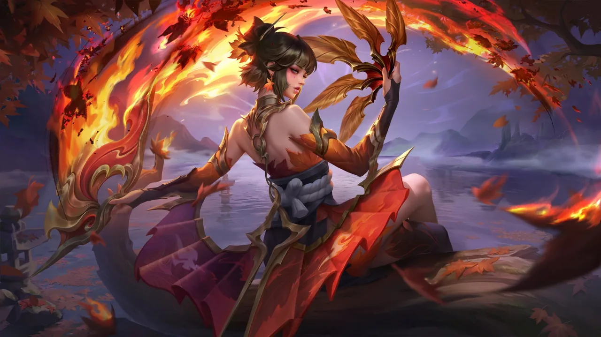

[Скины Хирары](https://boostmlbb.ru/skins/hirara.html)

[Скины](https://boostmlbb.ru/skins/)/[Хирара](https://boostmlbb.ru/skins/hirara.html)/Позолоченные угли

[Скин Хирары](https://boostmlbb.ru/skins/hirara.html)

# Позолоченные угли

Gilded Embers

Обычный CommonВ продаже

Как получить

Продаётся в магазине обликов за 269 алмазов.

Цена

269 алмазов

Вышел

17 июня 2026

## Что меняет облик

-   Бонус к характеристикам

**Сколько стоит буст на герое Хирара?**Выберите текущий и желаемый ранг. Стоимость появится на сайте.

[Рассчитать цену](https://boostmlbb.ru/order.html?type=hero)

## Частые вопросы

Как получить скин «Позолоченные угли» на Хирару?

Продаётся в магазине обликов за 269 алмазов.

Когда вышел скин «Позолоченные угли»?

17 июня 2026.

Какой класс у скина «Позолоченные угли»?

Обычный (Common).
