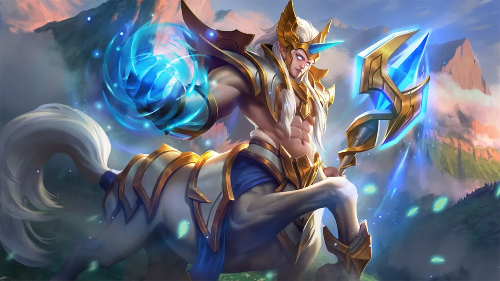

[Все скины](https://boostmlbb.ru/skins/)

[Скины](https://boostmlbb.ru/skins/)/Хилос

# Скины Хилоса

Скинов

6

Можно купить

2

Последний

[Владыка тундры](https://boostmlbb.ru/skins/hylos/lord-of-the-tundra.html)2025

[Профиль героя→](https://boostmlbb.ru/heroes/hylos.html)

## Все скины

[Владыка тундрыДелюкс · 2025](https://boostmlbb.ru/skins/hylos/lord-of-the-tundra.html)[Мародёр Кровавое КопытоОбычный · 2024](https://boostmlbb.ru/skins/hylos/bloodhoof-marauder.html)[Железный скакунДелюкс · 2021](https://boostmlbb.ru/skins/hylos/iron-steed.html)[Хранитель джунглейОбычный · 2019](https://boostmlbb.ru/skins/hylos/jungle-watcher.html)[Призрачный провидецИсключительный · 2018](https://boostmlbb.ru/skins/hylos/phantom-seer.html)[Шаман бездныОбычный · 2018](https://boostmlbb.ru/skins/hylos/abyssal-shaman.html)

**Сколько стоит буст на герое Хилос?**Выберите текущий и желаемый ранг. Стоимость появится на сайте.

[Рассчитать цену](https://boostmlbb.ru/order.html?type=hero)

## Частые вопросы

Сколько скинов у Хилоса?

6 скинов без стандартного облика. Последний — «Владыка тундры» (Lord of the Tundra), 18 декабря 2025.

Какие скины Хилоса можно купить сейчас?

«Призрачный провидец» (749 алмазов), «Шаман бездны» (599 алмазов). Остальные облики ограниченные и возвращаются только в событиях.

Какой самый редкий скин Хилоса?

«Владыка тундры» (Lord of the Tundra), класс делюкс, серия «Мифический сезон 2025». Цена на старте: 40 мифических монет. Сейчас в магазине не продаётся, возвращается только в событиях.
