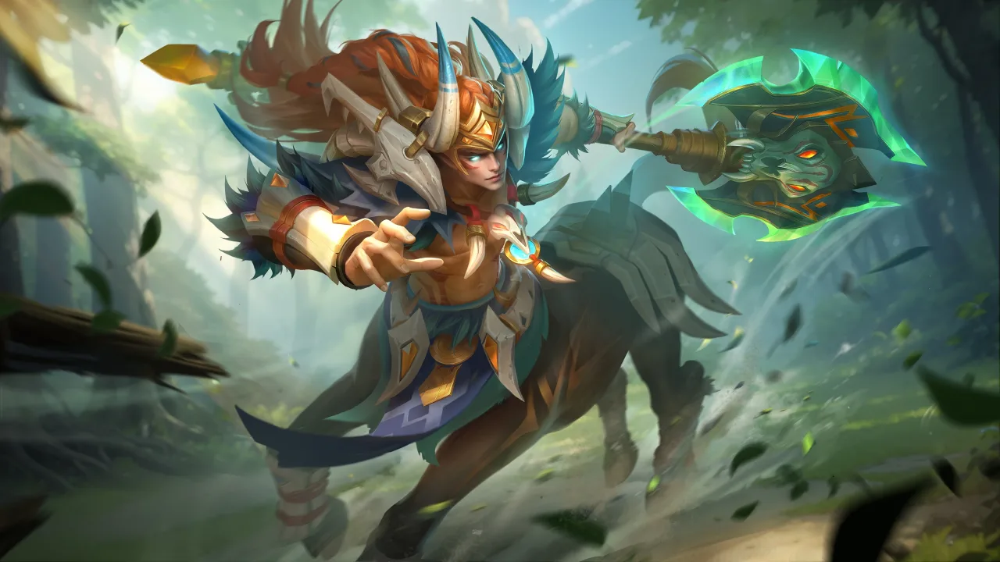

[Скины Хилоса](https://boostmlbb.ru/skins/hylos.html)

[Скины](https://boostmlbb.ru/skins/)/[Хилос](https://boostmlbb.ru/skins/hylos.html)/Мародёр Кровавое Копыто

[Скин Хилоса](https://boostmlbb.ru/skins/hylos.html)

# Мародёр Кровавое Копыто

Bloodhoof Marauder

Обычный CommonЭлитныйОграниченный

Как получить

Подарок за первое пополнение в сезоне 34.

Вышел

29 июня 2024

## Что меняет облик

-   Новая внешность
-   Другой цвет эффектов
-   Анимация показа
-   Бонус к характеристикам

## Все скины Хилоса [6](https://boostmlbb.ru/skins/hylos.html)

[Владыка тундрыДелюкс · 2025](https://boostmlbb.ru/skins/hylos/lord-of-the-tundra.html)[Мародёр Кровавое КопытоОбычный · 2024](https://boostmlbb.ru/skins/hylos/bloodhoof-marauder.html)[Железный скакунДелюкс · 2021](https://boostmlbb.ru/skins/hylos/iron-steed.html)[Хранитель джунглейОбычный · 2019](https://boostmlbb.ru/skins/hylos/jungle-watcher.html)[Призрачный провидецИсключительный · 2018](https://boostmlbb.ru/skins/hylos/phantom-seer.html)[Шаман бездныОбычный · 2018](https://boostmlbb.ru/skins/hylos/abyssal-shaman.html)

## Серия «Элитный»

[Золотой османтусЧан'Э · 2026](https://boostmlbb.ru/skins/change/golden-osmanthus.html)[Король-воена­чальникМартис · 2025](https://boostmlbb.ru/skins/martis/warlord-king.html)[Кадет открытого моряКимми · 2024](https://boostmlbb.ru/skins/kimmy/high-seas-cadet.html)[Зелёная копейщицаСильвана · 2024](https://boostmlbb.ru/skins/silvanna/verdant-lancer.html)[Изящная бабочкаГвиневра · 2024](https://boostmlbb.ru/skins/guinevere/elegant-butterfly.html)[Маркиз клинковЛанселот · 2024](https://boostmlbb.ru/skins/lancelot/marques-of-blades.html)[Привал в пустошахЧип · 2024](https://boostmlbb.ru/skins/chip/badlands-hiatus.html)[Звёздный фокусникХарли · 2024](https://boostmlbb.ru/skins/harley/star-magician.html)

**Сколько стоит буст на герое Хилос?**Выберите текущий и желаемый ранг. Стоимость появится на сайте.

[Рассчитать цену](https://boostmlbb.ru/order.html?type=hero)

## Частые вопросы

Как получить скин «Мародёр Кровавое Копыто» на Хилоса?

Подарок за первое пополнение в сезоне 34.

Когда вышел скин «Мародёр Кровавое Копыто»?

29 июня 2024.

Какой класс у скина «Мародёр Кровавое Копыто»?

Обычный (Common), серия «Элитный».
