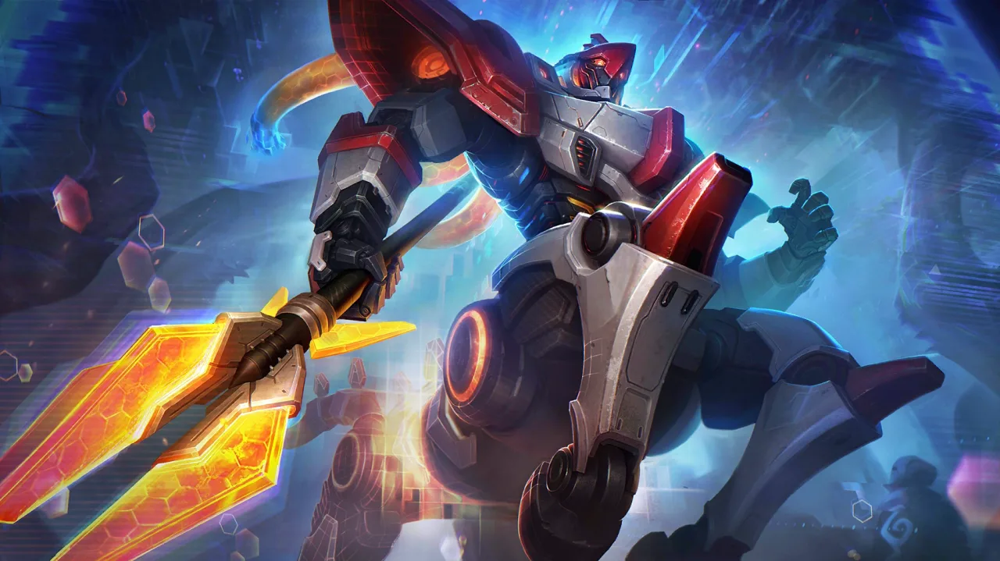

[Тир-лист](https://boostmlbb.ru/heroes/)[Предметы](https://boostmlbb.ru/items/)[Скины](https://boostmlbb.ru/skins/)[Новости и гайды](https://boostmlbb.ru/news/)

[Скины](https://boostmlbb.ru/skins/)/[Хилос](https://boostmlbb.ru/skins/hylos.html)/Железный скакун

[Скин Хилоса](https://boostmlbb.ru/skins/hylos.html)

# Железный скакун

Iron Steed

Делюкс DeluxeЭпическийОграниченный

Как получить

Выходил в магазине обликов во время события. Ограниченные облики иногда возвращаются в розыгрышах событий.

Вышел

9 октября 2021

## Что меняет облик

-   Новая внешность
-   Новые эффекты навыков
-   Звуки навыков
-   Анимация показа
-   Сцена показа
-   Бонус к характеристикам

## Все скины Хилоса [6](https://boostmlbb.ru/skins/hylos.html)

[Владыка тундрыДелюкс · 2025](https://boostmlbb.ru/skins/hylos/lord-of-the-tundra.html)[Мародёр Кровавое КопытоОбычный · 2024](https://boostmlbb.ru/skins/hylos/bloodhoof-marauder.html)[Железный скакунДелюкс · 2021](https://boostmlbb.ru/skins/hylos/iron-steed.html)[Хранитель джунглейОбычный · 2019](https://boostmlbb.ru/skins/hylos/jungle-watcher.html)[Призрачный провидецИсключительный · 2018](https://boostmlbb.ru/skins/hylos/phantom-seer.html)[Шаман бездныОбычный · 2018](https://boostmlbb.ru/skins/hylos/abyssal-shaman.html)

## Серия «Эпический»

[Надзи­ратель преис­поднейМинотавр · 2026](https://boostmlbb.ru/skins/minotaur/nether-overseer.html)[Затонувшее проклятиеАтлас · 2026](https://boostmlbb.ru/skins/atlas/sunken-curse.html)[Вечная клятваВексана · 2026](https://boostmlbb.ru/skins/vexana/eternal-vow.html)[Проклятый свитокХуфра · 2025](https://boostmlbb.ru/skins/khufra/cursed-scroll.html)[Охотница за душамиНаталья · 2025](https://boostmlbb.ru/skins/natalia/soul-huntress.html)[Граф кошмаровЛеоморд · 2025](https://boostmlbb.ru/skins/leomord/nightmare-count.html)[Вершитель звёздБелерик · 2025](https://boostmlbb.ru/skins/belerick/arbiter-of-stars.html)[Хранитель ветровВэйл · 2025](https://boostmlbb.ru/skins/vale/keeper-of-the-winds.html)

**Поднимем ранг на герое Хилос**Цена считается в калькуляторе

[Рассчитать цену](https://boostmlbb.ru/order.html?type=hero)

## Частые вопросы

Как получить скин «Железный скакун» на Хилоса?

Выходил в магазине обликов во время события. Ограниченные облики иногда возвращаются в розыгрышах событий.

Когда вышел скин «Железный скакун»?

9 октября 2021.

Какой класс у скина «Железный скакун»?

Делюкс (Deluxe), серия «Эпический».
