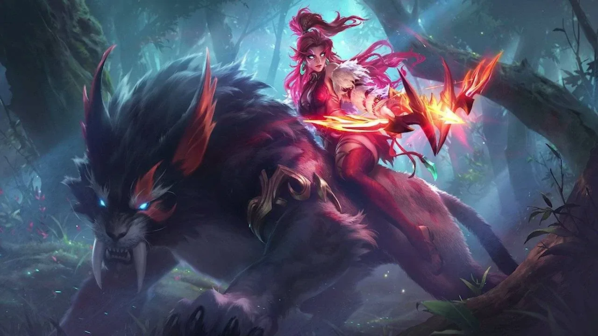

[Тир-лист](https://boostmlbb.ru/heroes/)[Предметы](https://boostmlbb.ru/items/)[Скины](https://boostmlbb.ru/skins/)[Новости и гайды](https://boostmlbb.ru/news/)

[Скины](https://boostmlbb.ru/skins/)/Иритель

# Скины Иритель

Скинов

7

Можно купить

2

Последний

[Клетчатый рыцарь](https://boostmlbb.ru/skins/irithel/checkered-knight.html)2025

[Профиль героя→](https://boostmlbb.ru/heroes/irithel.html)

## Все скины

ВсеГрандиозныйИзысканныйДелюксИсключительныйОбычный

[Клетчатый рыцарьИсключительный · 2025](https://boostmlbb.ru/skins/irithel/checkered-knight.html)[Гонщица на Monster SPГрандиозный · 2023](https://boostmlbb.ru/skins/irithel/monster-sp-rider.html)[Астральный странникИзысканный · 2019](https://boostmlbb.ru/skins/irithel/astral-wanderer.html)[СтрелецДелюкс · 2018](https://boostmlbb.ru/skins/irithel/sagittarius.html)[Ночная стрелаИсключительный · 2018](https://boostmlbb.ru/skins/irithel/nightarrow.html)[Адское пламяДелюкс · 2017](https://boostmlbb.ru/skins/irithel/hellfire.html)[Серебряный циклонОбычный · 2017](https://boostmlbb.ru/skins/irithel/silver-cyclone.html)

**Поднимем ранг на герое Иритель**Цена считается в калькуляторе

[Рассчитать цену](https://boostmlbb.ru/order.html?type=hero)

## Частые вопросы

Сколько скинов у Иритель?

7 скинов без стандартного облика. Последний — «Клетчатый рыцарь» (Checkered Knight), 1 февраля 2025.

Какие скины Иритель можно купить сейчас?

«Адское пламя» (899 алмазов), «Серебряный циклон» (269 алмазов). Остальные облики ограниченные и возвращаются только в событиях.

Какой самый редкий скин Иритель?

«Гонщица на Monster SP» (Monster SP Rider), класс грандиозный, серия «Ducati». Выходил в событии коллаборации MLBB × DUCATI.
