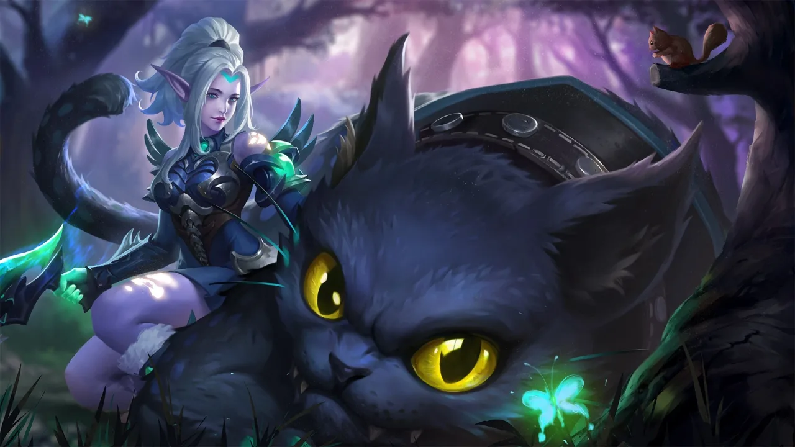
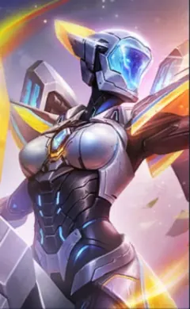

[Скины Иритель](https://boostmlbb.ru/skins/irithel.html)

[Скины](https://boostmlbb.ru/skins/)/[Иритель](https://boostmlbb.ru/skins/irithel.html)/Ночная стрела

[Скин Иритель](https://boostmlbb.ru/skins/irithel.html)

# Ночная стрела

Nightarrow

Исключительный ExceptionalЗвёздный участникОграниченный

Как получить

Награда «Звёздного участника» в марте 2018.

Вышел

1 марта 2018

## Что меняет облик

-   Новая внешность
-   Новые эффекты навыков
-   Анимация показа
-   Бонус к характеристикам

## Все скины Иритель [7](https://boostmlbb.ru/skins/irithel.html)

[Клетчатый рыцарьИсключительный · 2025](https://boostmlbb.ru/skins/irithel/checkered-knight.html)[Гонщица на Monster SPГрандиозный · 2023](https://boostmlbb.ru/skins/irithel/monster-sp-rider.html)[Астральный странникИзысканный · 2019](https://boostmlbb.ru/skins/irithel/astral-wanderer.html)[СтрелецДелюкс · 2018](https://boostmlbb.ru/skins/irithel/sagittarius.html)[Ночная стрелаИсключительный · 2018](https://boostmlbb.ru/skins/irithel/nightarrow.html)[Адское пламяДелюкс · 2017](https://boostmlbb.ru/skins/irithel/hellfire.html)[Серебряный циклонОбычный · 2017](https://boostmlbb.ru/skins/irithel/silver-cyclone.html)

## Серия «Звёздный участник»

[Морячка, рождённая приливомКалеа · 2026](https://boostmlbb.ru/skins/kalea/tideborn-sailor.html)[Тень кицунэХаябуса · 2026](https://boostmlbb.ru/skins/hayabusa/kitsune-s-shadow.html)[Клыки резниХанзо · 2026](https://boostmlbb.ru/skins/hanzo/fangs-of-slaughter.html)[Тлеющая крепостьБелерик · 2026](https://boostmlbb.ru/skins/belerick/smouldering-fortress.html)[Магитех­нический призракОбсидия · 2026](https://boostmlbb.ru/skins/obsidia/magitech-wraith.html)[Элизийское сияниеЦзэтянь · 2026](https://boostmlbb.ru/skins/zetian/elysian-luminance.html)[Батальон стражейХильда · 2026](https://boostmlbb.ru/skins/hilda/guardian-battalion.html)[Мечта­тельный коиХарли · 2026](https://boostmlbb.ru/skins/harley/dreaming-koi.html)

**Сколько стоит буст на герое Иритель?**Выберите текущий и желаемый ранг. Стоимость появится на сайте.

[Рассчитать цену](https://boostmlbb.ru/order.html?type=hero)

## Частые вопросы

Как получить скин «Ночная стрела» на Иритель?

Награда «Звёздного участника» в марте 2018.

Когда вышел скин «Ночная стрела»?

1 марта 2018.

Какой класс у скина «Ночная стрела»?

Исключительный (Exceptional), серия «Звёздный участник».
