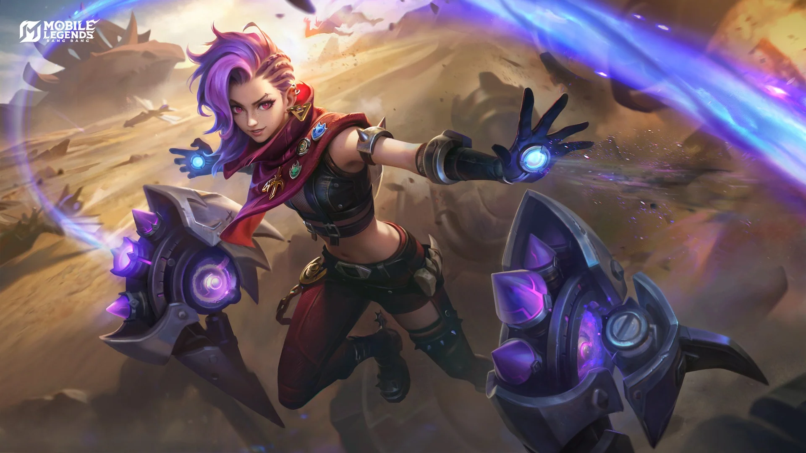

[Все скины](https://boostmlbb.ru/skins/)

[Скины](https://boostmlbb.ru/skins/)/Иксия

# Скины Иксии

Скинов

2

Можно купить

1

Последний

[Динамичная полоса](https://boostmlbb.ru/skins/ixia/dynamic-streak.html)2024

[Профиль героя→](https://boostmlbb.ru/heroes/ixia.html)

## Все скины

[Динамичная полосаИсключительный · 2024](https://boostmlbb.ru/skins/ixia/dynamic-streak.html)[Зыбучий песокОбычный · 2023](https://boostmlbb.ru/skins/ixia/shifting-sand.html)

**Сколько стоит буст на герое Иксия?**Выберите текущий и желаемый ранг. Стоимость появится на сайте.

[Рассчитать цену](https://boostmlbb.ru/order.html?type=hero)

## Частые вопросы

Сколько скинов у Иксии?

2 скина без стандартного облика. Последний — «Динамичная полоса» (Dynamic Streak), 1 марта 2024.

Какие скины Иксии можно купить сейчас?

«Зыбучий песок» (269 алмазов). Остальные облики ограниченные и возвращаются только в событиях.

Какой самый редкий скин Иксии?

«Динамичная полоса» (Dynamic Streak), класс исключительный, серия «Звёздный участник». Награда «Звёздного участника» в марте 2024.
