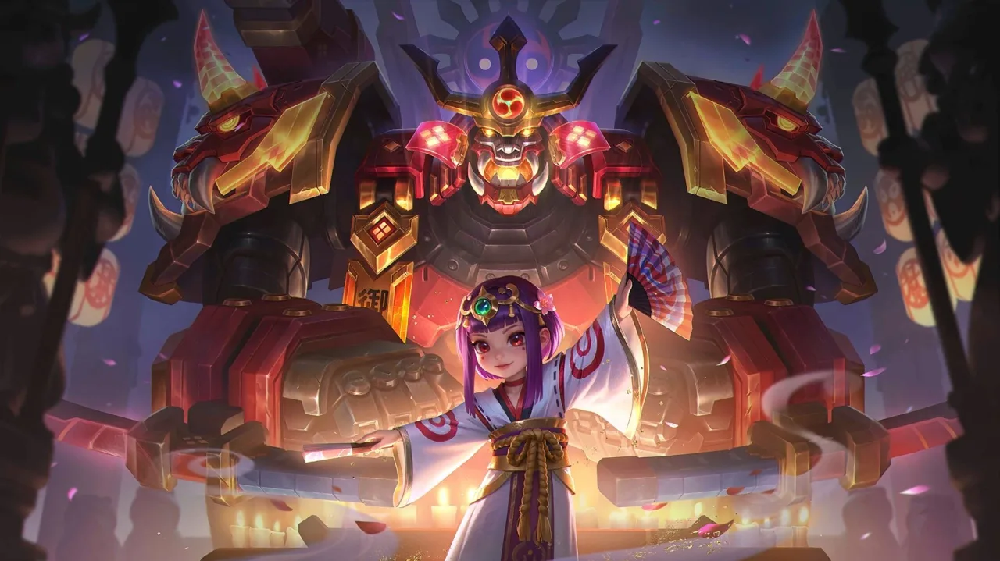

[Тир-лист](https://boostmlbb.ru/heroes/)[Предметы](https://boostmlbb.ru/items/)[Скины](https://boostmlbb.ru/skins/)[Новости и гайды](https://boostmlbb.ru/news/)

[Скины](https://boostmlbb.ru/skins/)/[Кусака](https://boostmlbb.ru/skins/jawhead.html)/Самурайский мех

[Скин Кусаки](https://boostmlbb.ru/skins/jawhead.html)

# Самурайский мех

Samurai Mech

Изысканный ExquisiteКоллекционныйОграниченный

Как получить

Главный приз розыгрыша в коллекционном событии, попытки покупаются за алмазы. Ограниченные облики иногда возвращаются в розыгрышах событий.

Вышел

декабрь 2020

## Что меняет облик

-   Новая внешность
-   Новые эффекты навыков
-   Анимация показа
-   Сцена показа
-   Бонус к характеристикам

## Все скины Кусаки [9](https://boostmlbb.ru/skins/jawhead.html)

[ПротостражДелюкс · 2025](https://boostmlbb.ru/skins/jawhead/proto-guardian.html)[Погрузчик победыОбычный · 2024](https://boostmlbb.ru/skins/jawhead/victory-loader.html)[Кибер-рейнджерИсключительный · 2023](https://boostmlbb.ru/skins/jawhead/cyber-ranger.html)[Конфетный мишкаИсключительный · 2021](https://boostmlbb.ru/skins/jawhead/candy-bear.html)[Саму­райский мехИзысканный · 2020](https://boostmlbb.ru/skins/jawhead/samurai-mech.html)[Квотербек ФуОбычный · 2019](https://boostmlbb.ru/skins/jawhead/foo-quarterback.html)[ЩелкунчикИсключительный · 2019](https://boostmlbb.ru/skins/jawhead/the-nutcracker.html)[Косми­ческий исследо­вательИсключительный · 2018](https://boostmlbb.ru/skins/jawhead/space-explorer.html)[Девочка-скаутОбычный · 2018](https://boostmlbb.ru/skins/jawhead/girl-scout.html)

## Серия «Коллекционный»

[ОчистительБруно · 2026](https://boostmlbb.ru/skins/bruno/the-purifier.html)[Небесный бунтарьСан · 2026](https://boostmlbb.ru/skins/sun/celestial-rebel.html)[Кайдзю глубинХелкарт · 2026](https://boostmlbb.ru/skins/helcurt/kaiju-of-the-deep.html)[Звёздный дозорныйКимми · 2026](https://boostmlbb.ru/skins/kimmy/starbound-sentry.html)[Монархиня грёзАлиса · 2026](https://boostmlbb.ru/skins/alice/dreaming-monarch.html)[Дрожь глубинГрок · 2026](https://boostmlbb.ru/skins/grock/tremor-of-the-deep.html)[Небесный генералТигрил · 2026](https://boostmlbb.ru/skins/tigreal/celestial-general.html)[Монарх, рождённый солнцемКсавьер · 2026](https://boostmlbb.ru/skins/xavier/sunborn-monarch.html)

**Поднимем ранг на герое Кусака**Цена считается в калькуляторе

[Рассчитать цену](https://boostmlbb.ru/order.html?type=hero)

## Частые вопросы

Как получить скин «Самурайский мех» на Кусаку?

Главный приз розыгрыша в коллекционном событии, попытки покупаются за алмазы. Ограниченные облики иногда возвращаются в розыгрышах событий.

Когда вышел скин «Самурайский мех»?

Декабрь 2020.

Какой класс у скина «Самурайский мех»?

Изысканный (Exquisite), серия «Коллекционный».
