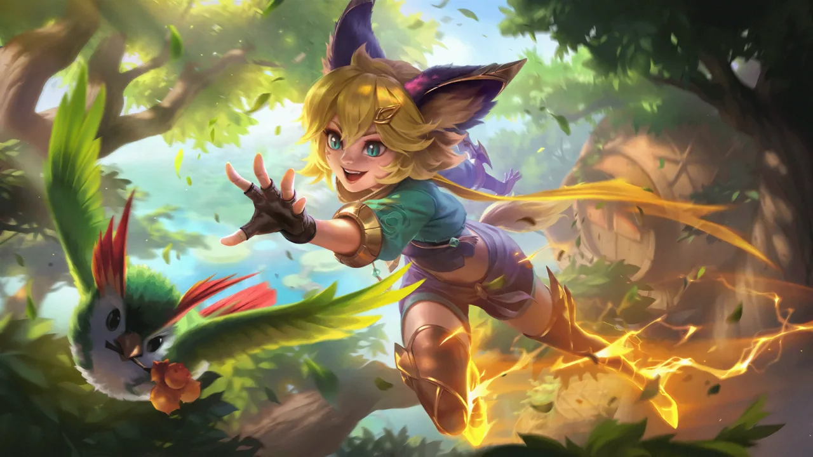

[Тир-лист](https://boostmlbb.ru/heroes/)[Предметы](https://boostmlbb.ru/items/)[Скины](https://boostmlbb.ru/skins/)[Новости и гайды](https://boostmlbb.ru/news/)

[Скины](https://boostmlbb.ru/skins/)/Джой

# Скины Джой

Скинов

3

Можно купить

2

Последний

[Разведчица Экзостар](https://boostmlbb.ru/skins/joy/exostar-scout.html)2025

[Профиль героя→](https://boostmlbb.ru/heroes/joy.html)

## Все скины

[Разведчица ЭкзостарИсключительный · 2025](https://boostmlbb.ru/skins/joy/exostar-scout.html)[Коро­левская защитницаОбычный · 2023](https://boostmlbb.ru/skins/joy/royal-protector.html)[Кошачий рейнджерОбычный · 2022](https://boostmlbb.ru/skins/joy/feline-ranger.html)

**Поднимем ранг на герое Джой**Цена считается в калькуляторе

[Рассчитать цену](https://boostmlbb.ru/order.html?type=hero)

## Частые вопросы

Сколько скинов у Джой?

3 скина без стандартного облика. Последний — «Разведчица Экзостар» (Exostar Scout), 1 апреля 2025.

Какие скины Джой можно купить сейчас?

«Королевская защитница» (599 алмазов), «Кошачий рейнджер» (269 алмазов). Остальные облики ограниченные и возвращаются только в событиях.

Какой самый редкий скин Джой?

«Разведчица Экзостар» (Exostar Scout), класс исключительный, серия «Звёздный участник». Награда «Звёздного участника» в апреле 2025.
