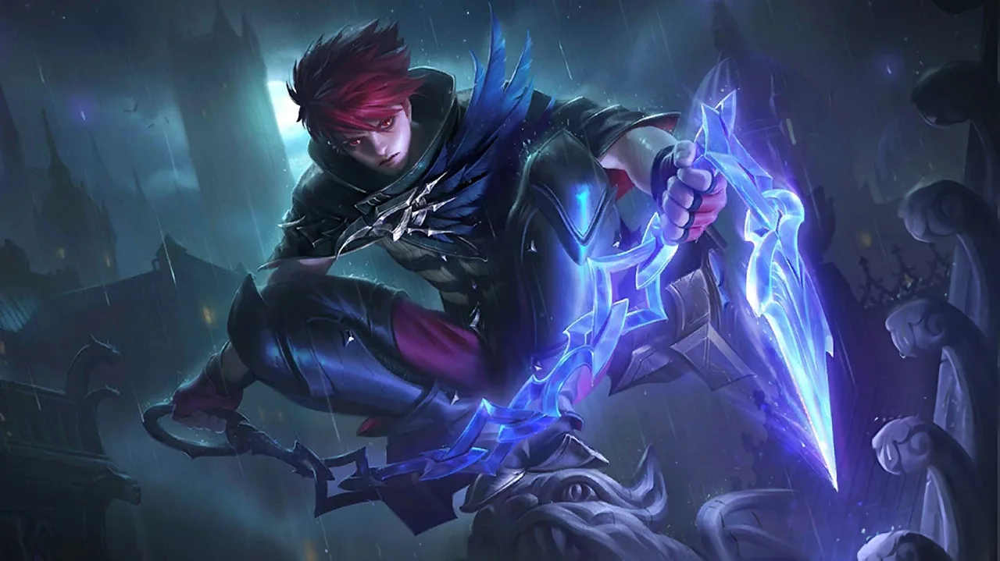

[Тир-лист](https://boostmlbb.ru/heroes/)[Предметы](https://boostmlbb.ru/items/)[Скины](https://boostmlbb.ru/skins/)[Новости и гайды](https://boostmlbb.ru/news/)

[Скины](https://boostmlbb.ru/skins/)/Джулиан

# Скины Джулиана

Скинов

5

Можно купить

1

Последний

[Следопыт Мяукинов](https://boostmlbb.ru/skins/julian/meowkin-tracker.html)2025

[Профиль героя→](https://boostmlbb.ru/heroes/julian.html)

## Все скины

[Следопыт МяукиновДелюкс · 2025](https://boostmlbb.ru/skins/julian/meowkin-tracker.html)[КурапикаГрандиозный · 2025](https://boostmlbb.ru/skins/julian/kurapika.html)[Мегуми ФушигуроГрандиозный · 2023](https://boostmlbb.ru/skins/julian/megumi-fushiguro.html)[Безмолвный клинокОбычный · 2022](https://boostmlbb.ru/skins/julian/silent-edge.html)[Итачи Учиха](https://boostmlbb.ru/skins/julian/itachi-uchiha.html)

**Поднимем ранг на герое Джулиан**Цена считается в калькуляторе

[Рассчитать цену](https://boostmlbb.ru/order.html?type=hero)

## Частые вопросы

Сколько скинов у Джулиана?

5 скинов без стандартного облика. Последний — «Следопыт Мяукинов» (Meowkin Tracker), 6 августа 2025.

Какие скины Джулиана можно купить сейчас?

«Безмолвный клинок» (269 алмазов). Остальные облики ограниченные и возвращаются только в событиях.

Какой самый редкий скин Джулиана?

«Курапика» (Kurapika), класс грандиозный, серия «Охотник × Охотник». Выходил в событии коллаборации MLBB × HUNTER×HUNTER.
