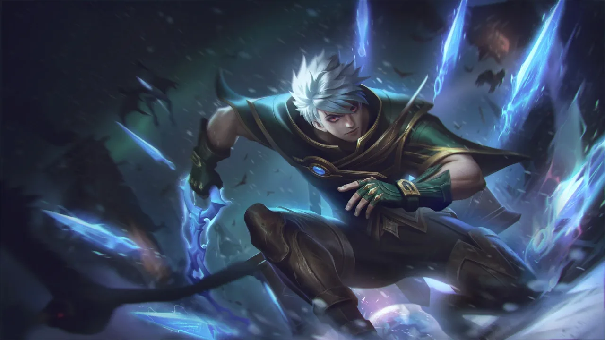

[Скины Джулиана](https://boostmlbb.ru/skins/julian.html)

[Скины](https://boostmlbb.ru/skins/)/[Джулиан](https://boostmlbb.ru/skins/julian.html)/Безмолвный клинок

[Скин Джулиана](https://boostmlbb.ru/skins/julian.html)

# Безмолвный клинок

Silent Edge

Обычный CommonВ продаже

Как получить

Продаётся в магазине обликов за 269 алмазов.

Цена

269 алмазов

Вышел

25 мая 2022

## Что меняет облик

-   Бонус к характеристикам

## Все скины Джулиана [5](https://boostmlbb.ru/skins/julian.html)

[Следопыт МяукиновДелюкс · 2025](https://boostmlbb.ru/skins/julian/meowkin-tracker.html)[КурапикаГрандиозный · 2025](https://boostmlbb.ru/skins/julian/kurapika.html)[Мегуми ФушигуроГрандиозный · 2023](https://boostmlbb.ru/skins/julian/megumi-fushiguro.html)[Безмолвный клинокОбычный · 2022](https://boostmlbb.ru/skins/julian/silent-edge.html)[Итачи Учиха](https://boostmlbb.ru/skins/julian/itachi-uchiha.html)

**Сколько стоит буст на герое Джулиан?**Выберите текущий и желаемый ранг. Стоимость появится на сайте.

[Рассчитать цену](https://boostmlbb.ru/order.html?type=hero)

## Частые вопросы

Как получить скин «Безмолвный клинок» на Джулиана?

Продаётся в магазине обликов за 269 алмазов.

Когда вышел скин «Безмолвный клинок»?

25 мая 2022.

Какой класс у скина «Безмолвный клинок»?

Обычный (Common).
