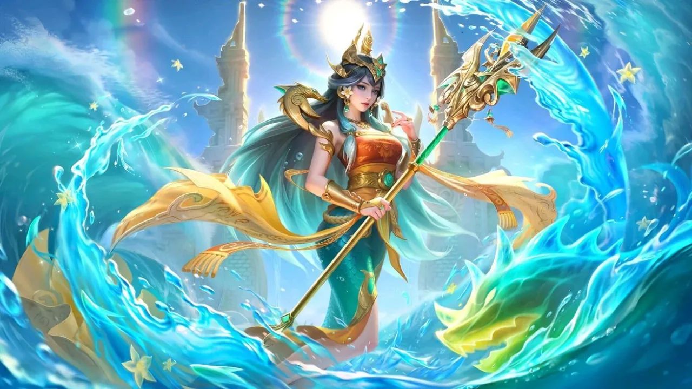

[Скины Кадиты](https://boostmlbb.ru/skins/kadita.html)

[Скины](https://boostmlbb.ru/skins/)/[Кадита](https://boostmlbb.ru/skins/kadita.html)/Сердце моря

[Скин Кадиты](https://boostmlbb.ru/skins/kadita.html)

# Сердце моря

Heart of the Sea

Делюкс DeluxeКонкурс обликовВ продаже

Как получить

Продаётся в магазине обликов за 899 алмазов.

Цена

899 алмазов

Вышел

3 июля 2024

## Что меняет облик

-   Новая внешность
-   Новые эффекты навыков
-   Звуки навыков
-   Анимация показа
-   Сцена показа
-   Бонус к характеристикам

## Все скины Кадиты [6](https://boostmlbb.ru/skins/kadita.html)

[Дева приливаИсключительный · 2025](https://boostmlbb.ru/skins/kadita/maiden-of-the-tide.html)[Сердце моряДелюкс · 2024](https://boostmlbb.ru/skins/kadita/heart-of-the-sea.html)[ГидромантИсключительный · 2023](https://boostmlbb.ru/skins/kadita/hydromancer.html)[Белая малиновкаИсключительный · 2019](https://boostmlbb.ru/skins/kadita/white-robin.html)[Принцесса АтлантидыОбычный · 2018](https://boostmlbb.ru/skins/kadita/atlantean-princess.html)[Гимн приливов](https://boostmlbb.ru/skins/kadita/anthem-of-tides.html)

## Серия «Конкурс обликов»

[Восходящий пламениЗилонг · 2026](https://boostmlbb.ru/skins/zilong/ascendant-of-flame.html)[Звёздная матронаЛо Йи · 2025](https://boostmlbb.ru/skins/luo-yi/starborne-matron.html)[Вестник адаГрейнджер · 2023](https://boostmlbb.ru/skins/granger/hellbringer.html)[Мудрица теченийОдетта · 2020](https://boostmlbb.ru/skins/odette/sage-of-the-currents.html)[Кибер-призракНаталья · 2020](https://boostmlbb.ru/skins/natalia/cyber-spectre.html)

**Сколько стоит буст на герое Кадита?**Выберите текущий и желаемый ранг. Стоимость появится на сайте.

[Рассчитать цену](https://boostmlbb.ru/order.html?type=hero)

## Частые вопросы

Как получить скин «Сердце моря» на Кадиту?

Продаётся в магазине обликов за 899 алмазов.

Когда вышел скин «Сердце моря»?

3 июля 2024.

Какой класс у скина «Сердце моря»?

Делюкс (Deluxe), серия «Конкурс обликов».
