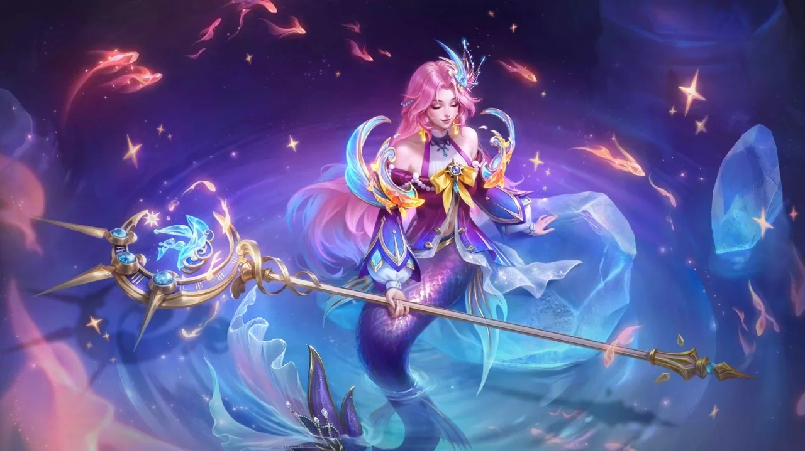

[Скины Кадиты](https://boostmlbb.ru/skins/kadita.html)

[Скины](https://boostmlbb.ru/skins/)/[Кадита](https://boostmlbb.ru/skins/kadita.html)/Дева прилива

[Скин Кадиты](https://boostmlbb.ru/skins/kadita.html)

# Дева прилива

Maiden of the Tide

Исключительный ExceptionalЗвёздный участникОграниченный

Как получить

Награда «Звёздного участника» в августе 2025.

Вышел

1 августа 2025

## Что меняет облик

-   Новая внешность
-   Новые эффекты навыков
-   Анимация показа
-   Сцена показа
-   Бонус к характеристикам

## Все скины Кадиты [6](https://boostmlbb.ru/skins/kadita.html)

[Дева приливаИсключительный · 2025](https://boostmlbb.ru/skins/kadita/maiden-of-the-tide.html)[Сердце моряДелюкс · 2024](https://boostmlbb.ru/skins/kadita/heart-of-the-sea.html)[ГидромантИсключительный · 2023](https://boostmlbb.ru/skins/kadita/hydromancer.html)[Белая малиновкаИсключительный · 2019](https://boostmlbb.ru/skins/kadita/white-robin.html)[Принцесса АтлантидыОбычный · 2018](https://boostmlbb.ru/skins/kadita/atlantean-princess.html)[Гимн приливов](https://boostmlbb.ru/skins/kadita/anthem-of-tides.html)

## Серия «Звёздный участник»

[Морячка, рождённая приливомКалеа · 2026](https://boostmlbb.ru/skins/kalea/tideborn-sailor.html)[Тень кицунэХаябуса · 2026](https://boostmlbb.ru/skins/hayabusa/kitsune-s-shadow.html)[Клыки резниХанзо · 2026](https://boostmlbb.ru/skins/hanzo/fangs-of-slaughter.html)[Тлеющая крепостьБелерик · 2026](https://boostmlbb.ru/skins/belerick/smouldering-fortress.html)[Магитех­нический призракОбсидия · 2026](https://boostmlbb.ru/skins/obsidia/magitech-wraith.html)[Элизийское сияниеЦзэтянь · 2026](https://boostmlbb.ru/skins/zetian/elysian-luminance.html)[Батальон стражейХильда · 2026](https://boostmlbb.ru/skins/hilda/guardian-battalion.html)[Мечта­тельный коиХарли · 2026](https://boostmlbb.ru/skins/harley/dreaming-koi.html)

**Сколько стоит буст на герое Кадита?**Выберите текущий и желаемый ранг. Стоимость появится на сайте.

[Рассчитать цену](https://boostmlbb.ru/order.html?type=hero)

## Частые вопросы

Как получить скин «Дева прилива» на Кадиту?

Награда «Звёздного участника» в августе 2025.

Когда вышел скин «Дева прилива»?

1 августа 2025.

Какой класс у скина «Дева прилива»?

Исключительный (Exceptional), серия «Звёздный участник».
