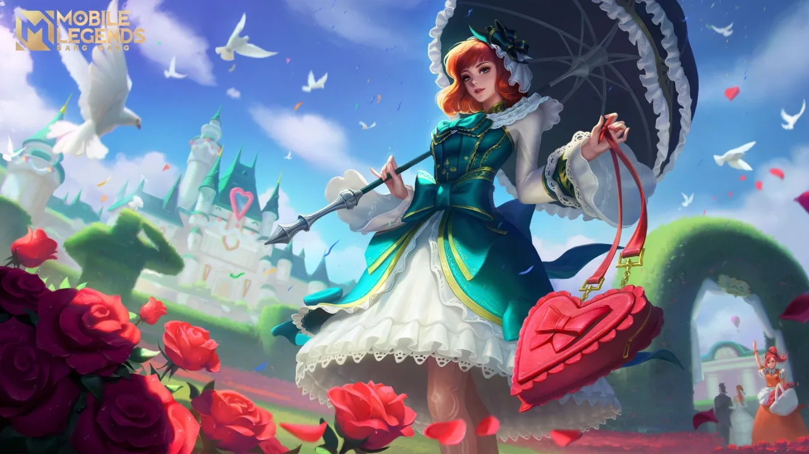

[Тир-лист](https://boostmlbb.ru/heroes/)[Предметы](https://boostmlbb.ru/items/)[Скины](https://boostmlbb.ru/skins/)[Новости и гайды](https://boostmlbb.ru/news/)

[Скины](https://boostmlbb.ru/skins/)/[Кагура](https://boostmlbb.ru/skins/kagura.html)/Сезон цветов

[Скин Кагуры](https://boostmlbb.ru/skins/kagura.html)

# Сезон цветов

Flower Season

Обычный CommonВ продаже

Как получить

Продаётся в магазине обликов за 269 алмазов.

Цена

269 алмазов

Вышел

2016 год

## Что меняет облик

-   Бонус к характеристикам

## Все скины Кагуры [11](https://boostmlbb.ru/skins/kagura.html)

[Леди с зонтикомИсключительный · 2025](https://boostmlbb.ru/skins/kagura/lady-parasol.html)[Нефритовый цветокДелюкс · 2024](https://boostmlbb.ru/skins/kagura/jade-blossom.html)[Кагура «За облаками»Изысканный · 2023](https://boostmlbb.ru/skins/kagura/beyond-the-clouds-kagura.html)[Экзор­цистка КагураГрандиозный · 2022](https://boostmlbb.ru/skins/kagura/exorcist-kagura.html)[КувшинкаИзысканный · 2021](https://boostmlbb.ru/skins/kagura/water-lily.html)[Прогулка под дождёмИсключительный · 2021](https://boostmlbb.ru/skins/kagura/rainy-walk.html)[Летний фестивальИсключительный · 2019](https://boostmlbb.ru/skins/kagura/summer-festival.html)[Дева драконаИзысканный · 2018](https://boostmlbb.ru/skins/kagura/dragon-maiden.html)[Вишнёвая ведьмаИсключительный · 2017](https://boostmlbb.ru/skins/kagura/cherry-witch.html)[Сезон цветовОбычный · 2016](https://boostmlbb.ru/skins/kagura/flower-season.html)[Пир вечности](https://boostmlbb.ru/skins/kagura/feast-of-eternity.html)

**Поднимем ранг на герое Кагура**Цена считается в калькуляторе

[Рассчитать цену](https://boostmlbb.ru/order.html?type=hero)

## Частые вопросы

Как получить скин «Сезон цветов» на Кагуру?

Продаётся в магазине обликов за 269 алмазов.

Когда вышел скин «Сезон цветов»?

2016 год.

Какой класс у скина «Сезон цветов»?

Обычный (Common).
