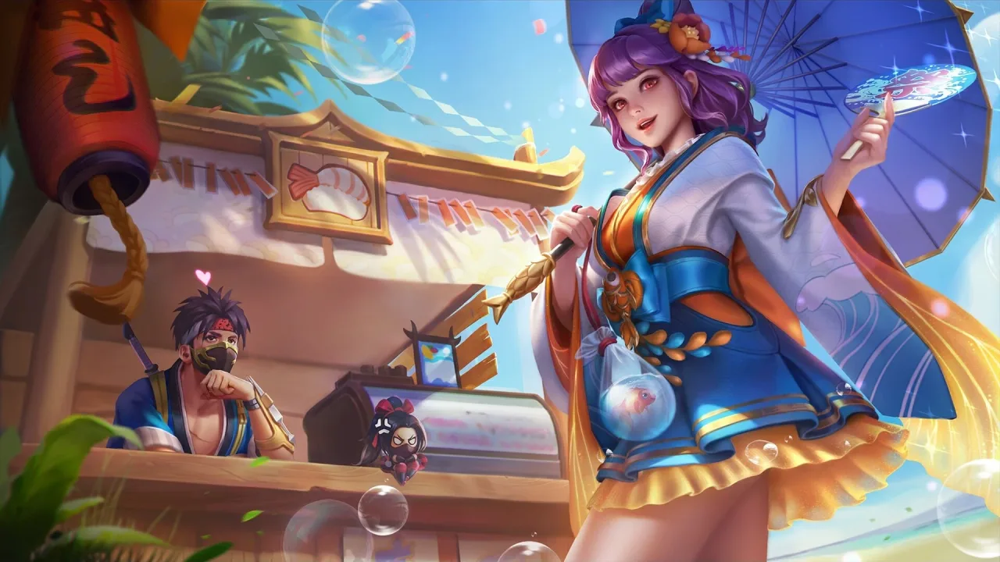

[Тир-лист](https://boostmlbb.ru/heroes/)[Предметы](https://boostmlbb.ru/items/)[Скины](https://boostmlbb.ru/skins/)[Новости и гайды](https://boostmlbb.ru/news/)

[Скины](https://boostmlbb.ru/skins/)/[Кагура](https://boostmlbb.ru/skins/kagura.html)/Летний фестиваль

[Скин Кагуры](https://boostmlbb.ru/skins/kagura.html)

# Летний фестиваль

Summer Festival

Исключительный ExceptionalЛетнийВ продаже

Как получить

Продаётся в магазине обликов за 749 алмазов.

Цена

749 алмазов

Вышел

2019 год

## Что меняет облик

-   Новая внешность
-   Новые эффекты навыков
-   Анимация показа
-   Бонус к характеристикам

## Перекраски

Тот же облик в других цветах. Перекраска открывается, только если у вас уже есть сам облик.

-   **Розовый летний фестиваль** Pink Summer Festival188 алмазов

## Все скины Кагуры [11](https://boostmlbb.ru/skins/kagura.html)

[Леди с зонтикомИсключительный · 2025](https://boostmlbb.ru/skins/kagura/lady-parasol.html)[Нефритовый цветокДелюкс · 2024](https://boostmlbb.ru/skins/kagura/jade-blossom.html)[Кагура «За облаками»Изысканный · 2023](https://boostmlbb.ru/skins/kagura/beyond-the-clouds-kagura.html)[Экзор­цистка КагураГрандиозный · 2022](https://boostmlbb.ru/skins/kagura/exorcist-kagura.html)[КувшинкаИзысканный · 2021](https://boostmlbb.ru/skins/kagura/water-lily.html)[Прогулка под дождёмИсключительный · 2021](https://boostmlbb.ru/skins/kagura/rainy-walk.html)[Летний фестивальИсключительный · 2019](https://boostmlbb.ru/skins/kagura/summer-festival.html)[Дева драконаИзысканный · 2018](https://boostmlbb.ru/skins/kagura/dragon-maiden.html)[Вишнёвая ведьмаИсключительный · 2017](https://boostmlbb.ru/skins/kagura/cherry-witch.html)[Сезон цветовОбычный · 2016](https://boostmlbb.ru/skins/kagura/flower-season.html)[Пир вечности](https://boostmlbb.ru/skins/kagura/feast-of-eternity.html)

## Серия «Летний»

[Летние брызгиВанван · 2025](https://boostmlbb.ru/skins/wanwan/summer-splash.html)[Официантка ятайФлорин · 2024](https://boostmlbb.ru/skins/floryn/yatai-waitress.html)[Летний бризГвиневра · 2024](https://boostmlbb.ru/skins/guinevere/summer-breeze.html)[Спаса­тельницаКлауд · 2024](https://boostmlbb.ru/skins/claude/lifeguard.html)[Летние волныЗилонг · 2020](https://boostmlbb.ru/skins/zilong/summer-waves.html)[Летнее настроениеАнгела · 2019](https://boostmlbb.ru/skins/angela/summer-vibes.html)[Летнее платьеНана · 2019](https://boostmlbb.ru/skins/nana/sundress.html)[Мастер сушиХаябуса · 2019](https://boostmlbb.ru/skins/hayabusa/sushi-master.html)

**Поднимем ранг на герое Кагура**Цена считается в калькуляторе

[Рассчитать цену](https://boostmlbb.ru/order.html?type=hero)

## Частые вопросы

Как получить скин «Летний фестиваль» на Кагуру?

Продаётся в магазине обликов за 749 алмазов.

Когда вышел скин «Летний фестиваль»?

2019 год.

Какой класс у скина «Летний фестиваль»?

Исключительный (Exceptional), серия «Летний».
