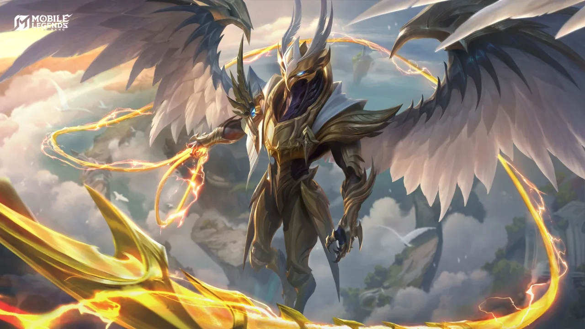

[Тир-лист](https://boostmlbb.ru/heroes/)[Предметы](https://boostmlbb.ru/items/)[Скины](https://boostmlbb.ru/skins/)[Новости и гайды](https://boostmlbb.ru/news/)

[Скины](https://boostmlbb.ru/skins/)/Кайя

# Скины Кайи

Скинов

6

Можно купить

2

Последний

[Адский надсмотрщик](https://boostmlbb.ru/skins/kaja/inferno-taskmaster.html)2023

[Профиль героя→](https://boostmlbb.ru/heroes/kaja.html)

## Все скины

[Адский надсмотрщикДелюкс · 2023](https://boostmlbb.ru/skins/kaja/inferno-taskmaster.html)[Ворон-магОбычный · 2020](https://boostmlbb.ru/skins/kaja/crow-magician.html)[Небесный заслонИзысканный · 2019](https://boostmlbb.ru/skins/kaja/skyblocker.html)[Хлыст ужасаОбычный · 2019](https://boostmlbb.ru/skins/kaja/horror-whiplash.html)[КаминариИсключительный · 2019](https://boostmlbb.ru/skins/kaja/kaminari.html)[ЗаповедьОбычный · 2018](https://boostmlbb.ru/skins/kaja/commandment.html)

**Поднимем ранг на герое Кайя**Цена считается в калькуляторе

[Рассчитать цену](https://boostmlbb.ru/order.html?type=hero)

## Частые вопросы

Сколько скинов у Кайи?

6 скинов без стандартного облика. Последний — «Адский надсмотрщик» (Inferno Taskmaster), 28 сентября 2023.

Какие скины Кайи можно купить сейчас?

«Хлыст ужаса» (599 алмазов), «Заповедь» (269 алмазов). Остальные облики ограниченные и возвращаются только в событиях.

Какой самый редкий скин Кайи?

«Небесный заслон» (Skyblocker), класс изысканный, серия «Ящик удачи». Выпадал из ящиков удачи в событиях. Ограниченные облики иногда возвращаются в розыгрышах событий.
