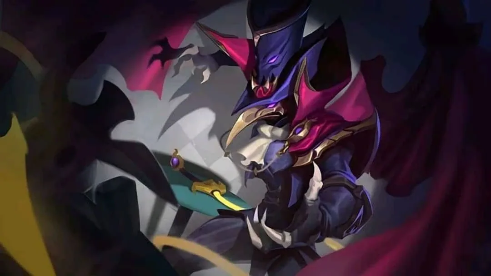

[Тир-лист](https://boostmlbb.ru/heroes/)[Предметы](https://boostmlbb.ru/items/)[Скины](https://boostmlbb.ru/skins/)[Новости и гайды](https://boostmlbb.ru/news/)

[Скины](https://boostmlbb.ru/skins/)/[Кайя](https://boostmlbb.ru/skins/kaja.html)/Ворон-маг

[Скин Кайи](https://boostmlbb.ru/skins/kaja.html)

# Ворон-маг

Crow Magician

Обычный CommonСезон 20Ограниченный

Как получить

Награда за рейтинговый сезон 20.

Вышел

19 июня 2020

## Что меняет облик

-   Новая внешность
-   Другой цвет эффектов
-   Анимация показа
-   Бонус к характеристикам

## Все скины Кайи [6](https://boostmlbb.ru/skins/kaja.html)

[Адский надсмотрщикДелюкс · 2023](https://boostmlbb.ru/skins/kaja/inferno-taskmaster.html)[Ворон-магОбычный · 2020](https://boostmlbb.ru/skins/kaja/crow-magician.html)[Небесный заслонИзысканный · 2019](https://boostmlbb.ru/skins/kaja/skyblocker.html)[Хлыст ужасаОбычный · 2019](https://boostmlbb.ru/skins/kaja/horror-whiplash.html)[КаминариИсключительный · 2019](https://boostmlbb.ru/skins/kaja/kaminari.html)[ЗаповедьОбычный · 2018](https://boostmlbb.ru/skins/kaja/commandment.html)

**Поднимем ранг на герое Кайя**Цена считается в калькуляторе

[Рассчитать цену](https://boostmlbb.ru/order.html?type=hero)

## Частые вопросы

Как получить скин «Ворон-маг» на Кайю?

Награда за рейтинговый сезон 20.

Когда вышел скин «Ворон-маг»?

19 июня 2020.

Какой класс у скина «Ворон-маг»?

Обычный (Common), серия «Сезон 20».
