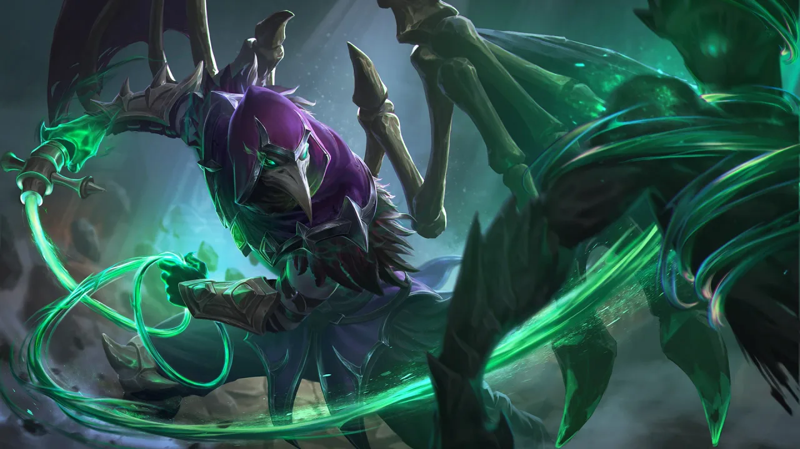

[Скины Кайи](https://boostmlbb.ru/skins/kaja.html)

[Скины](https://boostmlbb.ru/skins/)/[Кайя](https://boostmlbb.ru/skins/kaja.html)/Хлыст ужаса

[Скин Кайи](https://boostmlbb.ru/skins/kaja.html)

# Хлыст ужаса

Horror Whiplash

Обычный CommonЭлитныйВ продаже

Как получить

Продаётся в магазине обликов за 599 алмазов.

Цена

599 алмазов

Вышел

1 июля 2019

## Что меняет облик

-   Новая внешность
-   Другой цвет эффектов
-   Анимация показа
-   Бонус к характеристикам

## Перекраски

Тот же облик в других цветах. Перекраска открывается, только если у вас уже есть сам облик.

-   **Смертельный хлыст** Death WhiplashНаграда «Звёздного участника» в феврале 2021.

## Все скины Кайи [6](https://boostmlbb.ru/skins/kaja.html)

[Адский надсмотрщикДелюкс · 2023](https://boostmlbb.ru/skins/kaja/inferno-taskmaster.html)[Ворон-магОбычный · 2020](https://boostmlbb.ru/skins/kaja/crow-magician.html)[Небесный заслонИзысканный · 2019](https://boostmlbb.ru/skins/kaja/skyblocker.html)[Хлыст ужасаОбычный · 2019](https://boostmlbb.ru/skins/kaja/horror-whiplash.html)[КаминариИсключительный · 2019](https://boostmlbb.ru/skins/kaja/kaminari.html)[ЗаповедьОбычный · 2018](https://boostmlbb.ru/skins/kaja/commandment.html)

## Серия «Элитный»

[Золотой османтусЧан'Э · 2026](https://boostmlbb.ru/skins/change/golden-osmanthus.html)[Король-воена­чальникМартис · 2025](https://boostmlbb.ru/skins/martis/warlord-king.html)[Кадет открытого моряКимми · 2024](https://boostmlbb.ru/skins/kimmy/high-seas-cadet.html)[Зелёная копейщицаСильвана · 2024](https://boostmlbb.ru/skins/silvanna/verdant-lancer.html)[Мародёр Кровавое КопытоХилос · 2024](https://boostmlbb.ru/skins/hylos/bloodhoof-marauder.html)[Изящная бабочкаГвиневра · 2024](https://boostmlbb.ru/skins/guinevere/elegant-butterfly.html)[Маркиз клинковЛанселот · 2024](https://boostmlbb.ru/skins/lancelot/marques-of-blades.html)[Привал в пустошахЧип · 2024](https://boostmlbb.ru/skins/chip/badlands-hiatus.html)

**Сколько стоит буст на герое Кайя?**Выберите текущий и желаемый ранг. Стоимость появится на сайте.

[Рассчитать цену](https://boostmlbb.ru/order.html?type=hero)

## Частые вопросы

Как получить скин «Хлыст ужаса» на Кайю?

Продаётся в магазине обликов за 599 алмазов.

Когда вышел скин «Хлыст ужаса»?

1 июля 2019.

Какой класс у скина «Хлыст ужаса»?

Обычный (Common), серия «Элитный».
