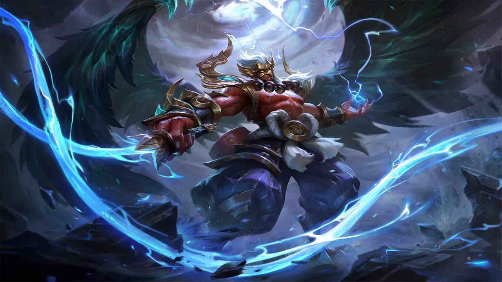

[Скины Кайи](https://boostmlbb.ru/skins/kaja.html)

[Скины](https://boostmlbb.ru/skins/)/[Кайя](https://boostmlbb.ru/skins/kaja.html)/Каминари

[Скин Кайи](https://boostmlbb.ru/skins/kaja.html)

# Каминари

Kaminari

Исключительный ExceptionalЗвёздный участникОграниченный

Как получить

Награда «Звёздного участника» в июне 2019.

Вышел

8 июня 2019

## Что меняет облик

-   Новая внешность
-   Новые эффекты навыков
-   Анимация показа
-   Бонус к характеристикам

## Все скины Кайи [6](https://boostmlbb.ru/skins/kaja.html)

[Адский надсмотрщикДелюкс · 2023](https://boostmlbb.ru/skins/kaja/inferno-taskmaster.html)[Ворон-магОбычный · 2020](https://boostmlbb.ru/skins/kaja/crow-magician.html)[Небесный заслонИзысканный · 2019](https://boostmlbb.ru/skins/kaja/skyblocker.html)[Хлыст ужасаОбычный · 2019](https://boostmlbb.ru/skins/kaja/horror-whiplash.html)[КаминариИсключительный · 2019](https://boostmlbb.ru/skins/kaja/kaminari.html)[ЗаповедьОбычный · 2018](https://boostmlbb.ru/skins/kaja/commandment.html)

## Серия «Звёздный участник»

[Морячка, рождённая приливомКалеа · 2026](https://boostmlbb.ru/skins/kalea/tideborn-sailor.html)[Тень кицунэХаябуса · 2026](https://boostmlbb.ru/skins/hayabusa/kitsune-s-shadow.html)[Клыки резниХанзо · 2026](https://boostmlbb.ru/skins/hanzo/fangs-of-slaughter.html)[Тлеющая крепостьБелерик · 2026](https://boostmlbb.ru/skins/belerick/smouldering-fortress.html)[Магитех­нический призракОбсидия · 2026](https://boostmlbb.ru/skins/obsidia/magitech-wraith.html)[Элизийское сияниеЦзэтянь · 2026](https://boostmlbb.ru/skins/zetian/elysian-luminance.html)[Батальон стражейХильда · 2026](https://boostmlbb.ru/skins/hilda/guardian-battalion.html)[Мечта­тельный коиХарли · 2026](https://boostmlbb.ru/skins/harley/dreaming-koi.html)

**Сколько стоит буст на герое Кайя?**Выберите текущий и желаемый ранг. Стоимость появится на сайте.

[Рассчитать цену](https://boostmlbb.ru/order.html?type=hero)

## Частые вопросы

Как получить скин «Каминари» на Кайю?

Награда «Звёздного участника» в июне 2019.

Когда вышел скин «Каминари»?

8 июня 2019.

Какой класс у скина «Каминари»?

Исключительный (Exceptional), серия «Звёздный участник».
