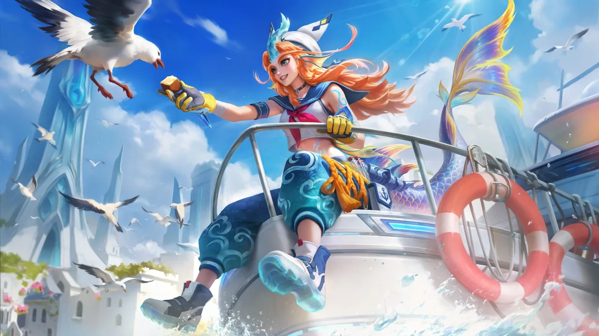

[Тир-лист](https://boostmlbb.ru/heroes/)[Предметы](https://boostmlbb.ru/items/)[Скины](https://boostmlbb.ru/skins/)[Новости и гайды](https://boostmlbb.ru/news/)

[Скины](https://boostmlbb.ru/skins/)/[Калеа](https://boostmlbb.ru/skins/kalea.html)/Морячка, рождённая приливом

[Скин Калеа](https://boostmlbb.ru/skins/kalea.html)

# Морячка, рождённая приливом

Tideborn Sailor

Звёздный участникОграниченный

Как получить

Облик «Звёздного участника» в ноябре 2026: его выдавали за покупку звёздного пропуска в этом месяце. Ограниченные облики иногда возвращаются в розыгрышах событий.

Вышел

ноябрь 2026

## Все скины Калеа [3](https://boostmlbb.ru/skins/kalea.html)

[Морячка, рождённая приливом2026](https://boostmlbb.ru/skins/kalea/tideborn-sailor.html)[Сакура ХаруноГрандиозный · 2025](https://boostmlbb.ru/skins/kalea/sakura-haruno.html)[Мерцающие волныОбычный · 2025](https://boostmlbb.ru/skins/kalea/shimmering-waves.html)

## Серия «Звёздный участник»

[Тень кицунэХаябуса · 2026](https://boostmlbb.ru/skins/hayabusa/kitsune-s-shadow.html)[Клыки резниХанзо · 2026](https://boostmlbb.ru/skins/hanzo/fangs-of-slaughter.html)[Тлеющая крепостьБелерик · 2026](https://boostmlbb.ru/skins/belerick/smouldering-fortress.html)[Магитех­нический призракОбсидия · 2026](https://boostmlbb.ru/skins/obsidia/magitech-wraith.html)[Элизийское сияниеЦзэтянь · 2026](https://boostmlbb.ru/skins/zetian/elysian-luminance.html)[Батальон стражейХильда · 2026](https://boostmlbb.ru/skins/hilda/guardian-battalion.html)[Мечта­тельный коиХарли · 2026](https://boostmlbb.ru/skins/harley/dreaming-koi.html)[Коро­левский маршалФредрин · 2025](https://boostmlbb.ru/skins/fredrinn/royal-marshal.html)

**Поднимем ранг на герое Калеа**Цена считается в калькуляторе

[Рассчитать цену](https://boostmlbb.ru/order.html?type=hero)

## Частые вопросы

Как получить скин «Морячка, рождённая приливом» на Калеа?

Облик «Звёздного участника» в ноябре 2026: его выдавали за покупку звёздного пропуска в этом месяце. Ограниченные облики иногда возвращаются в розыгрышах событий.

Когда вышел скин «Морячка, рождённая приливом»?

Ноябрь 2026.
