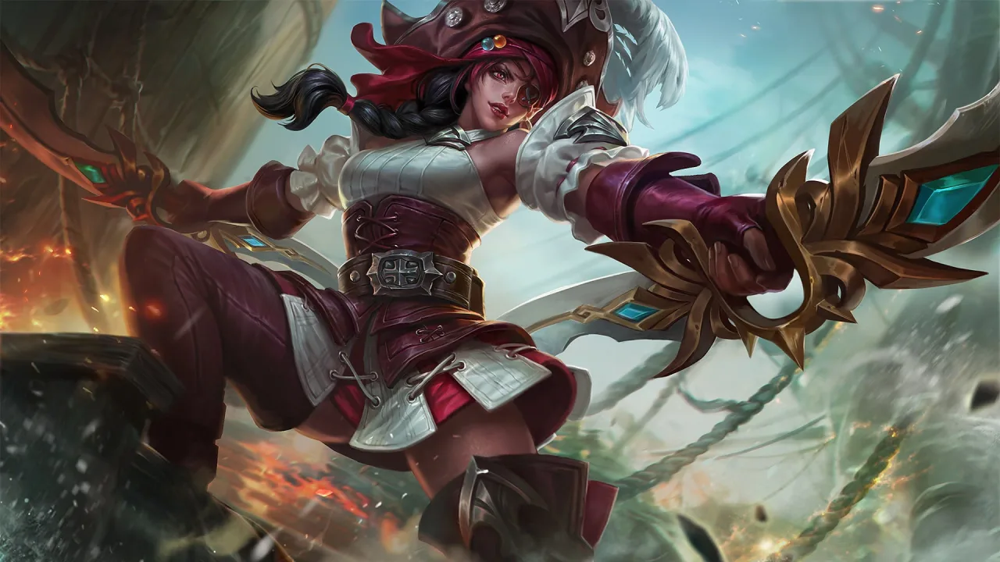

[Скины Карины](https://boostmlbb.ru/skins/karina.html)

[Скины](https://boostmlbb.ru/skins/)/[Карина](https://boostmlbb.ru/skins/karina.html)/Чёрная жемчужина

[Скин Карины](https://boostmlbb.ru/skins/karina.html)

# Чёрная жемчужина

Black Pearl

Исключительный ExceptionalЗвёздный участникОграниченный

Как получить

Награда «Звёздного участника» в июле 2017.

Вышел

1 июля 2017

## Что меняет облик

-   Новая внешность
-   Новые эффекты навыков
-   Анимация показа
-   Бонус к характеристикам

## Все скины Карины [9](https://boostmlbb.ru/skins/karina.html)

[Чемпионка ключаОбычный · 2025](https://boostmlbb.ru/skins/karina/keyforged-champion.html)[Кровавая лунаОбычный · 2020](https://boostmlbb.ru/skins/karina/blood-moon.html)[Близнецы: СияниеДелюкс · 2019](https://boostmlbb.ru/skins/karina/gemini-halo.html)[ЛеонаГрандиозный · 2019](https://boostmlbb.ru/skins/karina/leona.html)[Роковая дуэлянткаИзысканный · 2018](https://boostmlbb.ru/skins/karina/doom-duelist.html)[Паучья лилияОбычный · 2018](https://boostmlbb.ru/skins/karina/spider-lily.html)[Чёрная жемчужинаИсключительный · 2017](https://boostmlbb.ru/skins/karina/black-pearl.html)[Рож­дественский карнавалИсключительный · 2016](https://boostmlbb.ru/skins/karina/christmas-carnival.html)[Призрачный клинокОбычный · 2016](https://boostmlbb.ru/skins/karina/phantom-blade.html)

## Серия «Звёздный участник»

[Морячка, рождённая приливомКалеа · 2026](https://boostmlbb.ru/skins/kalea/tideborn-sailor.html)[Тень кицунэХаябуса · 2026](https://boostmlbb.ru/skins/hayabusa/kitsune-s-shadow.html)[Клыки резниХанзо · 2026](https://boostmlbb.ru/skins/hanzo/fangs-of-slaughter.html)[Тлеющая крепостьБелерик · 2026](https://boostmlbb.ru/skins/belerick/smouldering-fortress.html)[Магитех­нический призракОбсидия · 2026](https://boostmlbb.ru/skins/obsidia/magitech-wraith.html)[Элизийское сияниеЦзэтянь · 2026](https://boostmlbb.ru/skins/zetian/elysian-luminance.html)[Батальон стражейХильда · 2026](https://boostmlbb.ru/skins/hilda/guardian-battalion.html)[Мечта­тельный коиХарли · 2026](https://boostmlbb.ru/skins/harley/dreaming-koi.html)

**Сколько стоит буст на герое Карина?**Выберите текущий и желаемый ранг. Стоимость появится на сайте.

[Рассчитать цену](https://boostmlbb.ru/order.html?type=hero)

## Частые вопросы

Как получить скин «Чёрная жемчужина» на Карину?

Награда «Звёздного участника» в июле 2017.

Когда вышел скин «Чёрная жемчужина»?

1 июля 2017.

Какой класс у скина «Чёрная жемчужина»?

Исключительный (Exceptional), серия «Звёздный участник».
