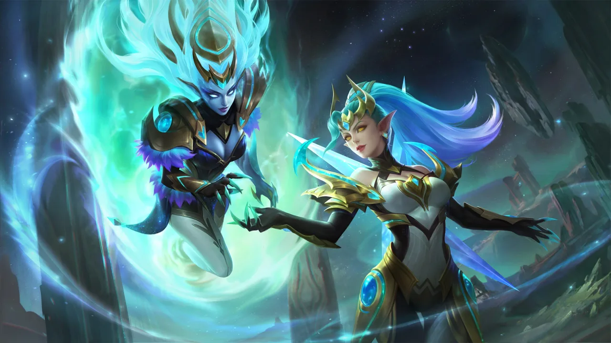

[Тир-лист](https://boostmlbb.ru/heroes/)[Предметы](https://boostmlbb.ru/items/)[Скины](https://boostmlbb.ru/skins/)[Новости и гайды](https://boostmlbb.ru/news/)

[Скины](https://boostmlbb.ru/skins/)/[Карина](https://boostmlbb.ru/skins/karina.html)/Близнецы: Сияние

[Скин Карины](https://boostmlbb.ru/skins/karina.html)

# Близнецы: Сияние

Gemini - Halo

Делюкс DeluxeЗодиакОграниченный

Как получить

Выпадает в розыгрыше «Зодиак» (Zodiac Summon).

Вышел

21 мая 2019

## Что меняет облик

-   Новая внешность
-   Новые эффекты навыков
-   Звуки навыков
-   Своя озвучка
-   Анимация показа
-   Сцена показа
-   Бонус к характеристикам

## Все скины Карины [9](https://boostmlbb.ru/skins/karina.html)

[Чемпионка ключаОбычный · 2025](https://boostmlbb.ru/skins/karina/keyforged-champion.html)[Кровавая лунаОбычный · 2020](https://boostmlbb.ru/skins/karina/blood-moon.html)[Близнецы: СияниеДелюкс · 2019](https://boostmlbb.ru/skins/karina/gemini-halo.html)[ЛеонаГрандиозный · 2019](https://boostmlbb.ru/skins/karina/leona.html)[Роковая дуэлянткаИзысканный · 2018](https://boostmlbb.ru/skins/karina/doom-duelist.html)[Паучья лилияОбычный · 2018](https://boostmlbb.ru/skins/karina/spider-lily.html)[Чёрная жемчужинаИсключительный · 2017](https://boostmlbb.ru/skins/karina/black-pearl.html)[Рож­дественский карнавалИсключительный · 2016](https://boostmlbb.ru/skins/karina/christmas-carnival.html)[Призрачный клинокОбычный · 2016](https://boostmlbb.ru/skins/karina/phantom-blade.html)

## Серия «Зодиак»

[КозерогМартис · 2022](https://boostmlbb.ru/skins/martis/capricorn.html)[СкорпионХелкарт · 2019](https://boostmlbb.ru/skins/helcurt/scorpio.html)[ВесыЛюнокс · 2019](https://boostmlbb.ru/skins/lunox/libra.html)[ЛевБаданг · 2019](https://boostmlbb.ru/skins/badang/leo.html)[РакЗаск · 2019](https://boostmlbb.ru/skins/zhask/cancer.html)[Близнецы: ТеньСелена · 2019](https://boostmlbb.ru/skins/selena/gemini-shadow.html)[ТелецМинотавр · 2019](https://boostmlbb.ru/skins/minotaur/taurus.html)[ОвенХильда · 2019](https://boostmlbb.ru/skins/hilda/aries.html)

**Поднимем ранг на герое Карина**Цена считается в калькуляторе

[Рассчитать цену](https://boostmlbb.ru/order.html?type=hero)

## Частые вопросы

Как получить скин «Близнецы: Сияние» на Карину?

Выпадает в розыгрыше «Зодиак» (Zodiac Summon).

Когда вышел скин «Близнецы: Сияние»?

21 мая 2019.

Какой класс у скина «Близнецы: Сияние»?

Делюкс (Deluxe), серия «Зодиак».
