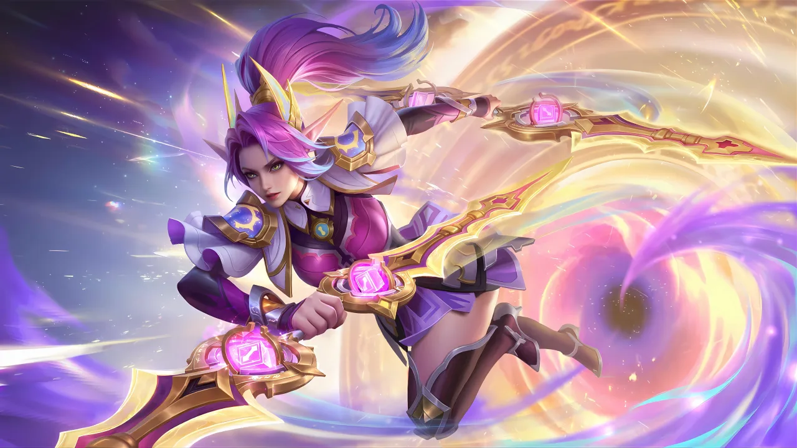
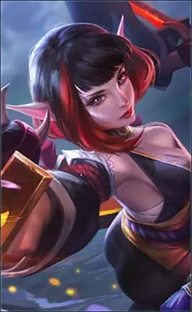

[Тир-лист](https://boostmlbb.ru/heroes/)[Предметы](https://boostmlbb.ru/items/)[Скины](https://boostmlbb.ru/skins/)[Новости и гайды](https://boostmlbb.ru/news/)

[Скины](https://boostmlbb.ru/skins/)/[Карина](https://boostmlbb.ru/skins/karina.html)/Чемпионка ключа

[Скин Карины](https://boostmlbb.ru/skins/karina.html)

# Чемпионка ключа

Keyforged Champion

Обычный CommonMagic Chess: Go GoОграниченный

Как получить

Выходил в событии «Magic Chess: Go Go». Ограниченные облики иногда возвращаются в розыгрышах событий.

Вышел

19 ноября 2025

## Что меняет облик

-   Новая внешность
-   Другой цвет эффектов
-   Анимация показа
-   Бонус к характеристикам

## Все скины Карины [9](https://boostmlbb.ru/skins/karina.html)

[Чемпионка ключаОбычный · 2025](https://boostmlbb.ru/skins/karina/keyforged-champion.html)[Кровавая лунаОбычный · 2020](https://boostmlbb.ru/skins/karina/blood-moon.html)[Близнецы: СияниеДелюкс · 2019](https://boostmlbb.ru/skins/karina/gemini-halo.html)[ЛеонаГрандиозный · 2019](https://boostmlbb.ru/skins/karina/leona.html)[Роковая дуэлянткаИзысканный · 2018](https://boostmlbb.ru/skins/karina/doom-duelist.html)[Паучья лилияОбычный · 2018](https://boostmlbb.ru/skins/karina/spider-lily.html)[Чёрная жемчужинаИсключительный · 2017](https://boostmlbb.ru/skins/karina/black-pearl.html)[Рож­дественский карнавалИсключительный · 2016](https://boostmlbb.ru/skins/karina/christmas-carnival.html)[Призрачный клинокОбычный · 2016](https://boostmlbb.ru/skins/karina/phantom-blade.html)

## Серия «Magic Chess: Go Go»

[Бунтарь ПекадосИкс.Борг · 2025](https://boostmlbb.ru/skins/x-borg/pecados-rioter.html)

**Поднимем ранг на герое Карина**Цена считается в калькуляторе

[Рассчитать цену](https://boostmlbb.ru/order.html?type=hero)

## Частые вопросы

Как получить скин «Чемпионка ключа» на Карину?

Выходил в событии «Magic Chess: Go Go». Ограниченные облики иногда возвращаются в розыгрышах событий.

Когда вышел скин «Чемпионка ключа»?

19 ноября 2025.

Какой класс у скина «Чемпионка ключа»?

Обычный (Common), серия «Magic Chess: Go Go».
